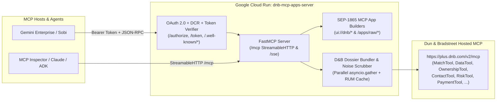
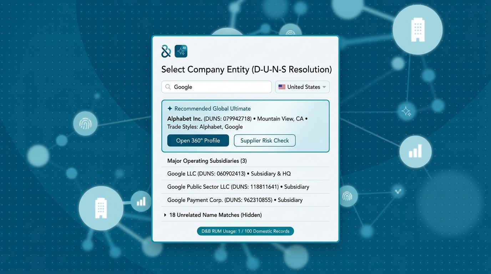
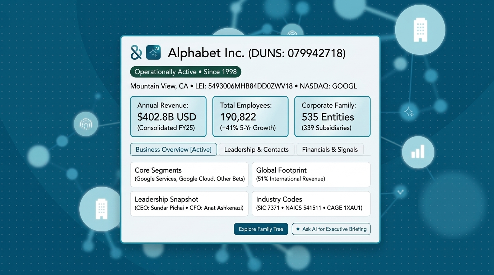
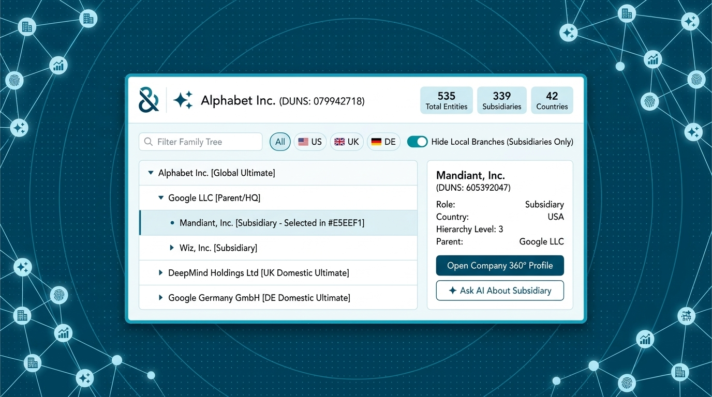
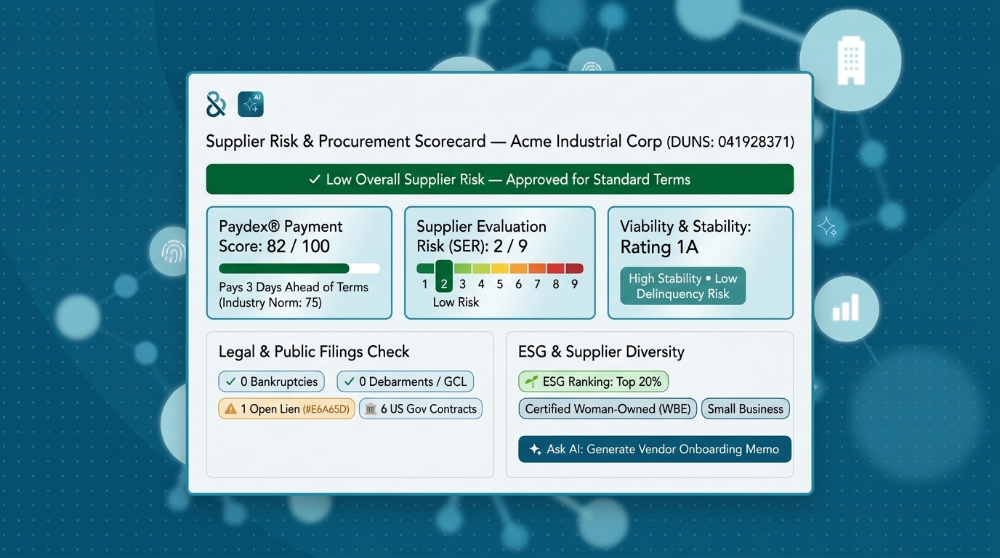

# Dun & Bradstreet (`dnb.ai` / `dnb.com`) Interactive MCP Apps Server

An enterprise-grade **Model Context Protocol (MCP) Server** and **Interactive Visual MCP Apps Suite (`SEP-1865`)** for **Dun & Bradstreet (D&B)** entity resolution (`D-U-N-S®` disambiguation), 360° executive company snapshots, global corporate family tree exploration, and supplier risk, credit & procurement KYB scorecards on **Google Cloud Run**.

Implemented as a standalone **MCP-over-MCP visual orchestration server**, `dnb_mcp_apps_server` sits in front of Dun & Bradstreet's official hosted MCP server (`https://plus.dnb.com/v2/mcp`), consolidating multi-tool D&B calls in parallel, scrubbing `<<NOTENTITLED>>` / `NOTAVAILABLE` noise, and rendering four interactive [`dnb.ai`](https://dnb.ai/) / [`dnb.com`](https://www.dnb.com/)-branded `ui://dnb/*` applications (`text/html;profile=mcp-app`).

---

## Table of Contents

1. [Overview & Key Capabilities](#1-overview--key-capabilities)
2. [Architecture & Repository Structure](#2-architecture--repository-structure)
3. [Interactive `ui://` MCP Apps (SEP-1865)](#3-interactive-ui-mcp-apps-sep-1865)
4. [Complete Reference of All 21 MCP Tools](#4-complete-reference-of-all-21-mcp-tools)
5. [How to Deploy to Google Cloud Run (Including OAuth 2.0 & `.env.deploy`)](#5-how-to-deploy-to-google-cloud-run-including-oauth-20--envdeploy)
6. [Registering with Gemini Enterprise & Gemini Sobi (`skill/`)](#6-registering-with-gemini-enterprise--gemini-sobi-skill)
7. [How to Use & Test the Tools](#7-how-to-use--test-the-tools)

---

## 1. Overview & Key Capabilities

Raw responses from D&B's upstream MCP tools (`DataTool`, `OwnershipTool`, `MatchTool`, `ContactTool`, `RiskTool`, `PaymentTool`) return 60–75 KB of nested markdown bullets and 500–1,700 line ASCII trees containing hundreds of `<<NOTENTITLED|REQUIRE ...>>` and `NOTAVAILABLE` placeholders.

This server transforms the D&B MCP ecosystem into **21 visual-ready MCP tools** (**4 dedicated interactive `ui://` MCP App launchers** + **17 standard D&B proxy tools**):

* **4 Official `dnb.ai`-Branded Interactive MCP Apps (`text/html;profile=mcp-app`)**:
  - **`ui://dnb/entity-matcher`**: Entity Resolution & `D-U-N-S®` Disambiguation card that separates the recommended Global Ultimate HQ (`99% Match Confidence`) and linked operating subsidiaries from unrelated standalone name homonyms.
  - **`ui://dnb/company-360-snapshot`**: Company 360° Executive Snapshot consolidating firmographics, consolidated financials, employee growth, 3-pill narrative switcher (`Overview & Operations`, `Strategy, AI & M&A`, `Leadership & Identifiers`), and an interactive **C-Suite Executive Briefing** modal.
  - **`ui://dnb/corporate-family-tree`**: Corporate Family Tree & Upward Linkage Explorer with live hierarchy search, country filter pills, a default `"Hide Local Branches (Subsidiaries Only)"` toggle, and a right-hand **Selected Entity Linkage Inspector**.
  - **`ui://dnb/supplier-risk-scorecard`**: Supplier Risk, Credit & Procurement Scorecard with 3 visual health bars (Financial Stability Percentile, Delinquency Credit Score, D&B PAYDEX® Trade Payment Score), Recommended Credit Limit, 4 KYB compliance checks, 1-click copyable ERP/Gov registration keys (`D-U-N-S`, `LEI`, `CAGE`, `GSA UEI`, `SIC`, `NAICS`), and an interactive **Vendor Approval Memo** generator.
* **Instant (`<50ms`) Zero-Network In-DOM Suite Transitions**:
  - Every `open_*_app` call concurrently fetches `DataTool`, `ContactTool`, and `OwnershipTool` via `asyncio.gather` and embeds all 4 app templates (`SUITE_TEMPLATES`) plus preloaded entity dossiers (`preloaded_dossiers`) inside `window.__DNB_SUITE_BUNDLE__`.
  - Clicking **"Open 360° Executive Snapshot →"**, **"Explore Corporate Family Tree"**, **"Run Supplier Risk & Credit Scorecard"**, **"← Entity Search"**, or any subsidiary card swaps views **100% in-DOM in `<50ms`**—working seamlessly even inside offline or CSP-restricted sandboxed preview iframes.
* **Server-Side Entitlement Scrubbing & RUM-Protecting Cache**:
  - Strips all `<<NOTENTITLED|REQUIRE ...>>` and `NOTAVAILABLE` markers (~85% context-window savings) and caches upstream D&B responses by `(tool_name, duns)` so switching views or inspecting nodes does not consume additional D&B Records Under Management (**RUM**) quota.
* **Multi-Tenant OAuth 2.0 + PKCE + Dynamic Client Registration (DCR)**:
  - Built-in RFC 8414 (`/.well-known/oauth-authorization-server`), RFC 9728 (`/.well-known/oauth-protected-resource`), RFC 7591 (`/register`), `/authorize`, and `/token` endpoints for seamless integration with **Gemini Enterprise**, **Gemini Sobi**, and standard MCP clients.

---

## 2. Architecture & Repository Structure



### Directory Layout

```text
dnb_mcp_apps_server/
├── Dockerfile                        # Production Python 3.12 Slim container image for Cloud Run
├── requirements.txt                  # Pinned Python dependencies (mcp, httpx, starlette, uvicorn, pydantic)
├── deploy.sh                         # One-command Cloud Run deployment script (reads gitignored .env.deploy)
├── .env.example                      # Sanitized environment & credential configuration template
├── .gitignore                        # Excludes .env, .env.deploy, *.local.*, and Python caches
├── .dockerignore                     # Excludes local .env files and design wireframes from container image
├── main.py                           # CLI & container entrypoint (--transport streamable-http | sse | stdio)
├── server.py                         # FastMCP server, 21 MCP tools, 4 ui:// resources, OAuth 2.0 & preview routes
├── mcp_apps/
│   ├── __init__.py
│   ├── brand_theme.py                # Official dnb.ai/dnb.com CSS tokens, SVG network canvas & in-DOM suite router
│   ├── entity_matcher_app.py         # App 1: Entity Resolution & D-U-N-S Disambiguation (ui://dnb/entity-matcher)
│   ├── company_360_app.py            # App 2: Company 360° Executive Snapshot (ui://dnb/company-360-snapshot)
│   ├── family_tree_app.py            # App 3: Corporate Family Tree Explorer (ui://dnb/corporate-family-tree)
│   └── supplier_risk_app.py          # App 4: Supplier Risk & Credit Scorecard (ui://dnb/supplier-risk-scorecard)
├── services/
│   ├── __init__.py
│   ├── dnb_client.py                 # Async JSON-RPC proxy to plus.dnb.com/v2/mcp, parsers & seed cache
│   └── seed_samples/                 # Verified D&B seed records for instant offline fallback (Alphabet & IBM)
├── design/
│   ├── mcp_apps_ux_design.md         # Architecture, brand theme & UX design specification
│   ├── entity_matcher_wireframe.jpg
│   ├── company_360_wireframe.jpg
│   ├── family_tree_wireframe.jpg
│   └── supplier_risk_wireframe.jpg
└── skill/
    ├── SKILL.md                      # Sanitized companion skill for dnb-mcp-apps-server
    ├── dnb_mcp_apps_skill.zip        # Ready-to-upload skill archive for dnb-mcp-apps-server
    ├── dnb_mcp_skill.zip             # Ready-to-upload skill archive for direct upstream D&B MCP
    └── upstream_dnb_mcp_skill/
        └── SKILL.md                  # Sanitized companion skill for direct plus.dnb.com/v2/mcp
```

---

## 3. Interactive `ui://` MCP Apps (SEP-1865)

All four MCP Apps are self-contained HTML5/CSS/SVG/JS bundles (`mimeType: "text/html;profile=mcp-app"`) styled with the official `dnb.ai` / `dnb.com` Petrol-Blue & Cyan-Cerulean palette (`#005172`, `#00435F`, `#002737`, `#3095B4`, `#F2F8F9`, `Avenir LT Std`) and an animated SVG data-network constellation backdrop.

### App 1: Entity Resolution & D-U-N-S® Disambiguation (`ui://dnb/entity-matcher`)


* **3 Summary KPI Cards**: Recommended Ultimate HQ, Linked Operating Units count, and Unlinked Name Homonyms count.
* **Recommended Global Ultimate Spotlight Card**: Highlights the primary headquarters entity with `99% Match Confidence`, `1-click D-U-N-S® copy`, physical address, trade styles, and instant (`<50ms`) launchers for **Open 360° Executive Snapshot →**, **Explore Corporate Family Tree**, and **Run Supplier Risk & Credit Scorecard**.
* **Linked Operating Subsidiaries Grid & Homonym Drawer**: Displays verified corporate family subsidiaries with live text filtering while collapsing unrelated name homonyms into an expandable drawer.

### App 2: Company 360° Executive Snapshot (`ui://dnb/company-360-snapshot`)


* **Executive Header & Identity Chips**: Legal name, copyable `D-U-N-S®` pill, active operating status & incorporation year, stock ticker (`NASDAQ`/`NYSE`), Fortune 1000 badge, HQ address, phone, and clickable corporate website.
* **3 High-Impact KPI Tiles**: Annual Consolidated Revenue (`USD`), Global Workforce & Multi-Year Growth %, and Corporate Family Footprint (Subsidiaries, Branches, Countries).
* **3-Pill Dossier Switcher + C-Suite Briefing Modal**: Switches between `Overview & Operations`, `Strategy, AI & M&A`, and `Leadership & Identifiers` (with 24+ verified executives from `ContactTool`), plus an interactive **✦ Ask AI for C-Suite Executive Briefing** modal with 1-click clipboard copy.

### App 3: Corporate Family Tree & Upward Linkage Explorer (`ui://dnb/corporate-family-tree`)


* **Upward Corporate Lineage Breadcrumb & 3 KPI Cards**: Displays the chain of ownership up to the Global Ultimate HQ alongside Total Corporate Family Members, Legal Subsidiaries vs. Branches, and Global Reach (Countries & Domestic Ultimates).
* **Interactive Hierarchy Controls**: Live search box, **`Hide Local Branches (Subsidiaries Only)`** toggle (enabled by default to eliminate branch noise), **`Expand All`** / **`Level 1 Only`** buttons, and **Country Filter Pills**.
* **2-Column Master-Detail Inspector**: Clicking any node in the hierarchy updates the right-hand **Selected Entity Linkage Inspector** with roles, parent linkage, direct child subsidiaries, and 1-click transitions to that entity's **360° Snapshot** or **Supplier Risk Scorecard**.

### App 4: Supplier Risk, Credit & Procurement Scorecard (`ui://dnb/supplier-risk-scorecard`)


* **Procurement Approval Banner & Credit Limit**: Displays overall supplier risk status (`✓ LOW RISK • APPROVED VENDOR`), D&B Viability Rating (`1A1`), and Recommended Commercial Credit Limit.
* **3 Visual Credit & Risk Gauges**: Financial Stability Percentile (`0–100`), Delinquency Credit Score (`0–100`), and D&B PAYDEX® Trade Payment Score (`0–100` with payment terms promptness).
* **KYB Compliance Screening & Copyable ERP Keys**: 4 compliance cards (Operating & Legal Status, Corporate Hierarchy Linkage, Legal Events/Liens/Bankruptcies, Indirect Network Watchlist & Trust Index) alongside 1-click copyable registration keys (`D-U-N-S®`, `LEI`, `US DoD CAGE Code`, `GSA SAM.gov UEI`, `Corporate Registry #`, `Primary US SIC`, `Primary NAICS`) and an interactive **✦ Generate Vendor Approval Memo** modal.

---

## 4. Complete Reference of All 21 MCP Tools

| # | Tool Name | Category | Linked `ui://` Resource | Description |
|---|---|---|---|---|
| 1 | `open_entity_matcher_app` | Interactive MCP App | `ui://dnb/entity-matcher` | Resolves a company name/ticker and country via `MatchTool`, preloads all 4 app views, and opens the Entity Matcher (`EmbeddedResource` + JSON). |
| 2 | `open_company_360_app` | Interactive MCP App | `ui://dnb/company-360-snapshot` | Concurrently fetches `DataTool`, `ContactTool`, and `OwnershipTool` for a D-U-N-S or company name and opens the Company 360° Executive Snapshot. |
| 3 | `open_corporate_family_tree_app` | Interactive MCP App | `ui://dnb/corporate-family-tree` | Parses the full multi-country `OwnershipTool` hierarchy for a D-U-N-S or company name and opens the Corporate Family Tree Explorer. |
| 4 | `open_supplier_risk_scorecard_app` | Interactive MCP App | `ui://dnb/supplier-risk-scorecard` | Consolidates credit, PAYDEX, KYB compliance, and ERP registration identifiers for a D-U-N-S or company name and opens the Supplier Risk Scorecard. |
| 5 | `MatchTool` | D&B Proxy Tool | `ui://dnb/entity-matcher` | Matches a company name and ISO country code (`countryISOAlpha2Code`) to verified 9-digit D-U-N-S candidates. |
| 6 | `DataTool` | D&B Proxy Tool | `ui://dnb/company-360-snapshot` | Retrieves comprehensive D&B firmographics, financial statements, industry codes, and narrative summaries for a 9-digit D-U-N-S. |
| 7 | `ContactTool` | D&B Proxy Tool | `ui://dnb/company-360-snapshot` | Retrieves senior executives, principals, and leadership contact details for a 9-digit D-U-N-S. |
| 8 | `OwnershipTool` | D&B Proxy Tool | `ui://dnb/corporate-family-tree` | Retrieves corporate family tree hierarchy, Global/Domestic Ultimate parents, subsidiaries, branches, and UBO/CBO ownership. |
| 9 | `RiskTool` | D&B Proxy Tool | `ui://dnb/supplier-risk-scorecard` | Retrieves D&B Viability Rating, SER, SSI, Failure Score, Delinquency Score, and risk indicators. |
| 10 | `PaymentTool` | D&B Proxy Tool | `ui://dnb/supplier-risk-scorecard` | Retrieves D&B PAYDEX® scores, payment behavior relative to terms, and trade credit line breakdowns. |
| 11 | `BusinessEventsTool` | D&B Proxy Tool | `ui://dnb/supplier-risk-scorecard` | Retrieves lawsuits, liens, judgments, bankruptcies, debarments, UCC filings, and US Government awards. |
| 12 | `ESGTool` | D&B Proxy Tool | `ui://dnb/supplier-risk-scorecard` | Retrieves Environmental, Social, and Governance (ESG) rankings and theme breakdowns. |
| 13 | `DiversityTool` | D&B Proxy Tool | `ui://dnb/supplier-risk-scorecard` | Retrieves supplier diversity certifications (MBE, WBE, Veteran-Owned, HUBZone, 8(a)). |
| 14 | `SalesAndMarketingTool` | D&B Proxy Tool | `ui://dnb/company-360-snapshot` | Retrieves Decision Headquarter (DHQ) power, Buydex spend scores, and Material Change propensity models. |
| 15 | `NewsTool` | D&B Proxy Tool | `ui://dnb/company-360-snapshot` | Retrieves recent news and media events categorized by business topic for a 9-digit D-U-N-S. |
| 16 | `IndustryProfileTool` | D&B Proxy Tool | `ui://dnb/company-360-snapshot` | Retrieves D&B industry research profiles, benchmarks, and valuation multiples. |
| 17 | `ShippingTool` | D&B Proxy Tool | `ui://dnb/supplier-risk-scorecard` | Retrieves global trade and shipping volume insights (shipper, consignee, notify party). |
| 18 | `SBRITool` | D&B Proxy Tool | `ui://dnb/supplier-risk-scorecard` | Retrieves Small Business Risk Insight (SBRI) commercial loan, lease, and card utilization metrics. |
| 19 | `InquiryTool` | D&B Proxy Tool | `ui://dnb/supplier-risk-scorecard` | Retrieves commercial credit inquiry statistics and volume trends. |
| 20 | `ProvenanceTool` | D&B Proxy Tool | `ui://dnb/company-360-snapshot` | Retrieves official corporate registry filing provenance for KYB verification. |
| 21 | `RumSpendTool` | D&B Proxy Tool | `ui://dnb/entity-matcher` | Checks D&B Records Under Management (RUM) contract entitlement and consumption. |

---

## 5. How to Deploy to Google Cloud Run (Including OAuth 2.0 & `.env.deploy`)

### Option A: One-Command Deployment with Gitignored `.env.deploy` (Recommended)

To keep project IDs, OAuth credentials, and connector IDs out of source control while preserving them for instant future redeployments:

1. Copy `.env.example` to `.env.deploy` (which is ignored by `.gitignore` and `.dockerignore`):
   ```bash
   cd dnb_mcp_apps_server
   cp .env.example .env.deploy
   ```
2. Edit `.env.deploy` with your Google Cloud Project ID, Project Number, OAuth Client ID/Secret, and upstream D&B token/connector settings.
3. Run `./deploy.sh`:
   ```bash
   ./deploy.sh
   ```
   `deploy.sh` automatically sources `.env.deploy`, builds the container image via Cloud Build, deploys `dnb-mcp-apps-server` to Cloud Run, and configures all runtime environment variables.

---

### Option B: Manual Step-by-Step Cloud Run Deployment

1. **Set Environment Variables & Enable APIs**:
   ```bash
   export PROJECT_ID="your-gcp-project-id"
   export REGION="us-central1"
   export SERVICE_NAME="dnb-mcp-apps-server"

   gcloud config set project "${PROJECT_ID}"
   gcloud services enable run.googleapis.com cloudbuild.googleapis.com secretmanager.googleapis.com
   ```

2. **Create OAuth 2.0 Web Application Credentials**:
   - In **Google Cloud Console > APIs & Services > Credentials**, create an **OAuth client ID** of type **Web application**.
   - Add the Gemini Enterprise redirect URI under **Authorized redirect URIs**:
     ```text
     https://vertexaisearch.cloud.google.com/oauth-redirect
     ```

3. **Deploy to Google Cloud Run**:
   ```bash
   gcloud run deploy "${SERVICE_NAME}" \
     --source . \
     --project "${PROJECT_ID}" \
     --region "${REGION}" \
     --allow-unauthenticated \
     --memory 1Gi \
     --cpu 1 \
     --min-instances 0 \
     --max-instances 5 \
     --set-env-vars="MCP_TRANSPORT=streamable-http,DNB_UPSTREAM_MCP_URL=https://plus.dnb.com/v2/mcp,GOOGLE_OAUTH_CLIENT_ID=YOUR_OAUTH_CLIENT_ID,GOOGLE_OAUTH_CLIENT_SECRET=YOUR_OAUTH_CLIENT_SECRET"
   ```

4. **Update `PUBLIC_BASE_URL` with the Deployed Cloud Run URL**:
   ```bash
   SERVICE_URL=$(gcloud run services describe "${SERVICE_NAME}" --project "${PROJECT_ID}" --region "${REGION}" --format="value(status.url)")
   gcloud run services update "${SERVICE_NAME}" \
     --project "${PROJECT_ID}" \
     --region "${REGION}" \
     --update-env-vars="PUBLIC_BASE_URL=${SERVICE_URL}"
   ```

5. **Verify Health & OAuth Discovery Endpoints**:
   ```bash
   curl -s "${SERVICE_URL}/health" | jq .
   curl -s "${SERVICE_URL}/.well-known/oauth-authorization-server" | jq .
   curl -s "${SERVICE_URL}/.well-known/oauth-protected-resource" | jq .
   ```

---

## 6. Registering with Gemini Enterprise & Gemini Sobi (`skill/`)

### 6.1 Registering the MCP Server in Gemini Enterprise (Discovery Engine)
Register the deployed Cloud Run service in Gemini Enterprise as a Custom MCP (`custom_mcp`) connector:

```bash
export GE_PROJECT_ID="your-gemini-enterprise-project-id"
export COLLECTION_ID="dnb-mcp-apps"
export OAUTH_CLIENT_ID="YOUR_GOOGLE_OAUTH_CLIENT_ID"
export OAUTH_CLIENT_SECRET="YOUR_GOOGLE_OAUTH_CLIENT_SECRET"

TOKEN=$(gcloud auth print-access-token)

# 1. Create the Collection
curl -s -X POST \
  -H "Authorization: Bearer ${TOKEN}" \
  -H "Content-Type: application/json" \
  -H "X-Goog-User-Project: ${GE_PROJECT_ID}" \
  "https://discoveryengine.googleapis.com/v1alpha/projects/${GE_PROJECT_ID}/locations/global/collections?collectionId=${COLLECTION_ID}" \
  -d '{"displayName": "Dun & Bradstreet Interactive MCP Apps"}'

# 2. Configure the DataConnector
curl -s -X PATCH \
  -H "Authorization: Bearer ${TOKEN}" \
  -H "Content-Type: application/json" \
  -H "X-Goog-User-Project: ${GE_PROJECT_ID}" \
  "https://discoveryengine.googleapis.com/v1alpha/projects/${GE_PROJECT_ID}/locations/global/collections/${COLLECTION_ID}/dataConnector?updateMask=*" \
  -d "{
    \"name\": \"projects/${GE_PROJECT_ID}/locations/global/collections/${COLLECTION_ID}/dataConnector\",
    \"dataSource\": \"custom_mcp\",
    \"connectorType\": \"THIRD_PARTY\",
    \"actionConfig\": {
      \"actionParams\": {
        \"mcp_server_uri\": \"${SERVICE_URL}/mcp\",
        \"authorization_Endpoint\": \"${SERVICE_URL}/authorize\",
        \"token_endpoint\": \"${SERVICE_URL}/token\",
        \"client_id\": \"${OAUTH_CLIENT_ID}\",
        \"client_secret\": \"${OAUTH_CLIENT_SECRET}\",
        \"scopes\": \"openid email profile\"
      },
      \"isActionConfigured\": true
    },
    \"bapConfig\": {
      \"supportedConnectorModes\": [\"ACTIONS\"]
    }
  }"
```

### 6.2 Onboarding the Companion Skills (`skill/`) in Gemini Sobi
The [`skill/`](./skill/) directory includes two sanitized companion skills:
1. **[`skill/SKILL.md`](./skill/SKILL.md) (`dnb_mcp_apps_skill.zip`)**: Companion skill for this **`dnb-mcp-apps-server`** (invoking `open_entity_matcher_app`, `open_company_360_app`, `open_corporate_family_tree_app`, `open_supplier_risk_scorecard_app`, and all 17 proxy tools with automatic `/workspace/deliverables/index.html` Canvas publishing).
2. **[`skill/upstream_dnb_mcp_skill/SKILL.md`](./skill/upstream_dnb_mcp_skill/SKILL.md) (`dnb_mcp_skill.zip`)**: Companion skill for invoking D&B's direct upstream MCP endpoint (`https://plus.dnb.com/v2/mcp`).

Before uploading to Gemini Enterprise / Sobi:
1. Replace `<YOUR_PROJECT_NUMBER>` and `<YOUR_CLOUD_RUN_SERVICE_URL>` in `skill/SKILL.md`.
2. Re-package the zip archive:
   ```bash
   cd skill && zip -q -r dnb_mcp_apps_skill.zip SKILL.md && cd ..
   ```

---

## 7. How to Use & Test the Tools

### 7.1 Running Locally for Development

```bash
cd dnb_mcp_apps_server
python3 -m venv .venv
source .venv/bin/activate
pip install -r requirements.txt

# Run locally on http://localhost:8080
python3 main.py --transport streamable-http --port 8080
```

### 7.2 Interactive Browser Previews (`/apps/raw/*`)
While running locally (or on Cloud Run), you can test all 4 interactive `dnb.ai`-branded MCP Apps directly in your browser:
* **App 1 — Entity Matcher**:
  - `http://localhost:8080/apps/raw/entity-matcher?name=Google&country=US`
  - `http://localhost:8080/apps/raw/entity-matcher?name=IBM&country=US`
* **App 2 — Company 360° Executive Snapshot**:
  - `http://localhost:8080/apps/raw/company-360-snapshot?duns=079942718`
  - `http://localhost:8080/apps/raw/company-360-snapshot?duns=001368083`
* **App 3 — Corporate Family Tree Explorer**:
  - `http://localhost:8080/apps/raw/corporate-family-tree?duns=079942718`
* **App 4 — Supplier Risk, Credit & Procurement Scorecard**:
  - `http://localhost:8080/apps/raw/supplier-risk-scorecard?duns=079942718`

### 7.3 Testing via JSON-RPC (`/mcp`)

```bash
# List all 21 tools
curl -s -X POST "http://localhost:8080/mcp" \
  -H "Content-Type: application/json" \
  -H "Accept: application/json, text/event-stream" \
  -d '{
    "jsonrpc": "2.0",
    "id": 1,
    "method": "tools/list",
    "params": {}
  }' | jq .

# Invoke open_company_360_app for Alphabet Inc. (079942718)
curl -s -X POST "http://localhost:8080/mcp" \
  -H "Content-Type: application/json" \
  -H "Accept: application/json, text/event-stream" \
  -d '{
    "jsonrpc": "2.0",
    "id": 2,
    "method": "tools/call",
    "params": {
      "name": "open_company_360_app",
      "arguments": {
        "duns": "079942718"
      }
    }
  }' | jq .
```

### 7.4 Sample Natural Language Prompts for Gemini Enterprise / Sobi

* **Entity Resolution & D-U-N-S® Disambiguation (`open_entity_matcher_app`)**:
  > *"Search Dun & Bradstreet for 'Intuitive Surgical' (ISRG) in the US, disambiguate its Global Ultimate HQ D-U-N-S number from linked subsidiaries, and open the interactive Entity Matcher."*
* **Company 360° Executive Snapshot (`open_company_360_app`)**:
  > *"Open the D&B Company 360° Executive Snapshot for IBM (D-U-N-S 00-136-8083) showing its consolidated revenue, global workforce, key executives, and strategic overview."*
* **Corporate Family Tree & Linkage (`open_corporate_family_tree_app`)**:
  > *"Open the interactive D&B Corporate Family Tree for Alphabet Inc. (079942718) and show its legal operating subsidiaries across countries."*
* **Supplier Risk, Credit & KYB Onboarding (`open_supplier_risk_scorecard_app`)**:
  > *"Run a D&B Supplier Risk, Credit & KYB Procurement Scorecard for D-U-N-S 079942718 and generate a Vendor Risk Approval Memo with its LEI, CAGE code, and GSA UEI."*
