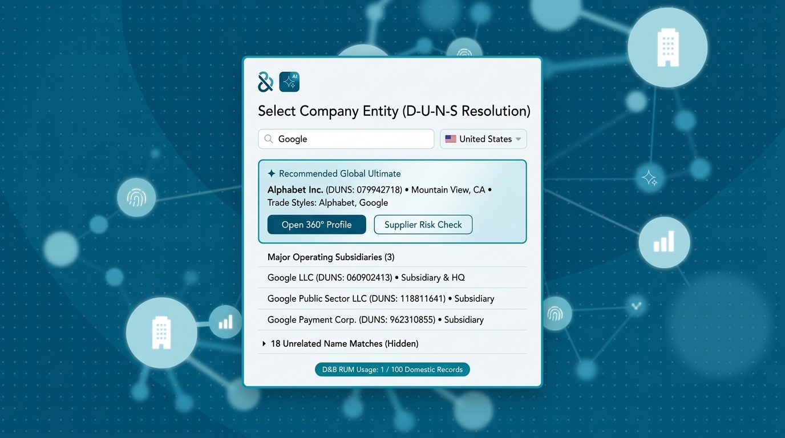
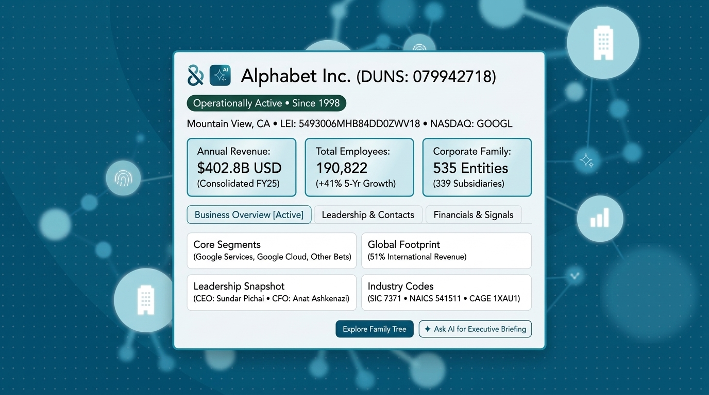
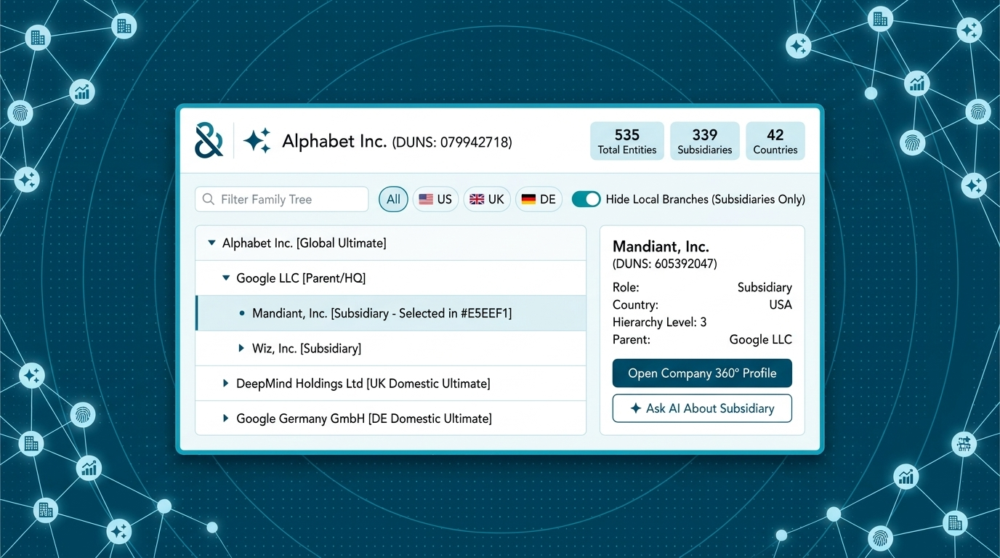
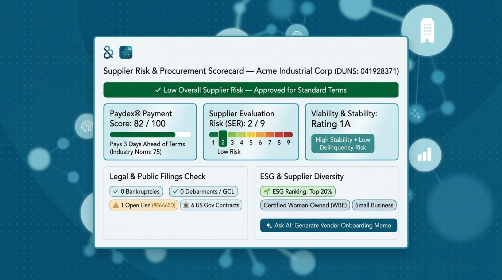

# Dun & Bradstreet (`dnb.ai` / `dnb.com`) MCP Apps — Architecture, Brand Theme & UX Design Specification

**Brand & Visual Reference:** [`https://dnb.ai/`](https://dnb.ai/) and [`https://www.dnb.com/`](https://www.dnb.com/)  
**Upstream D&B MCP Server:** `https://plus.dnb.com/v2/mcp` (StreamableHTTP JSON-RPC 2.0)  
**Target Standalone MCP Apps Server:** [`dnb_mcp_apps_server/`](../)  
**Protocol Specification:** Model Context Protocol — MCP Apps Extension (**SEP-1865**, `ui://` URI scheme, MIME type `text/html;profile=mcp-app`, bidirectional JSON-RPC 2.0 over `window.parent.postMessage`)

---

## 1. Standalone MCP-Over-MCP Visual Experience Architecture

`dnb_mcp_apps_server` is implemented as a standalone Cloud Run MCP server that sits in front of Dun & Bradstreet's official hosted MCP server (`https://plus.dnb.com/v2/mcp`) without requiring any modifications to D&B's backend.

```mermaid
sequenceDiagram
    participant Host as Gemini Enterprise / MCP Host UI
    participant AppsServer as dnb_mcp_apps_server (Cloud Run)
    participant DnBServer as D&B Official MCP Server (https://plus.dnb.com/v2/mcp)

    Host->>AppsServer: 1. tools/call (e.g., open_company_360_app, open_family_tree_app, or DataTool)
    AppsServer->>DnBServer: 2. Parallel JSON-RPC tools/call (MatchTool, DataTool, ContactTool, OwnershipTool, RumSpendTool)
    DnBServer-->>AppsServer: 3. Raw 60KB–75KB markdown/ASCII text (with <<NOTENTITLED>> & NOTAVAILABLE noise)
    AppsServer->>AppsServer: 4. Parses markdown/ASCII tree -> structured JSON, scrubs <<NOTENTITLED>> noise, caches by DUNS
    AppsServer-->>Host: 5. CallToolResult (Clean Summary + EmbeddedResource ui://dnb/... + structuredContent)
    Host->>Host: 6. Mounts sandboxed iframe (text/html;profile=mcp-app) with dnb.ai theme & network background
    Host->>AppsServer: 7. User clicks subsidiary or action inside iframe -> postMessage(tools/call) / HTTP fallback
    AppsServer->>DnBServer: 8. Fetches DataTool + ContactTool (or uses DUNS cache) for target entity
    DnBServer-->>AppsServer: 9. Upstream D&B response
    AppsServer-->>Host: 10. Updates UI card live in-place inside iframe
```

### 1.1 Key Architectural Capabilities of `dnb_mcp_apps_server`
1. **Zero Changes Required to D&B's Hosted MCP Server:** Connects directly to `https://plus.dnb.com/v2/mcp` via async JSON-RPC 2.0 (`tools/call`).
2. **Parallel Multi-Tool Consolidation:**
   * Opening the **Company 360° Snapshot** (`open_company_360_app`) fans out concurrently across `DataTool`, `ContactTool`, `OwnershipTool`, and `RumSpendTool` (resolving company names via `MatchTool` automatically if a 9-digit DUNS is not supplied).
   * Opening the **Supplier Risk Scorecard** (`open_supplier_risk_scorecard_app`) fans out across `RiskTool`, `PaymentTool`, `BusinessEventsTool`, `ESGTool`, `DiversityTool`, and `DataTool`.
3. **Server-Side Parsing & Entitlement Noise Scrubbing (~85% Context Window Savings):**
   * D&B's upstream tools return 60–75 KB of bulleted text and 535-line ASCII trees littered with `<<NOTENTITLED|REQUIRE ...>>` and `NOTAVAILABLE`.
   * `dnb_mcp_apps_server/services/dnb_client.py` parses those raw markdown tables, bullet lists, and ASCII trees into structured JSON (`structuredContent`), strips all `<<NOTENTITLED>>` placeholders, and provides clear entitlement tier badges when specific risk/financial datablocks require higher D&B package entitlements.
4. **In-Memory Per-DUNS Cache to Protect D&B RUM Quota:**
   * Because D&B tracks **Records Under Management (RUM)** usage (`RumSpendTool`), `dnb_mcp_apps_server` caches upstream tool responses per `(tool_name, duns)` with configurable TTL so switching tabs, filtering the family tree, or re-opening a card does not consume extra D&B calls.
5. **Dual-Mode Authentication to `https://plus.dnb.com/v2/mcp`:**
   * **Mode 1 — Header / Token Passthrough:** If an incoming request carries a D&B OAuth Bearer token (or `X-DnB-Token` header), `dnb_mcp_apps_server` forwards it to `https://plus.dnb.com/v2/mcp`.
   * **Mode 2 — Secret Manager / Environment Fallback (`DNB_MCP_BEARER_TOKEN`):** Uses the configured service-level D&B Bearer token (or `/tmp/dnb_token.txt` in local dev) so sandboxed `srcdoc` iframe calls (`/apps/api/tool-call`) and standalone browser previews (`/apps/raw/*`) authenticate seamlessly.
6. **Dual-Delivery Support Across All MCP Hosts:**
   * Registers all 4 `@mcp.resource("ui://dnb/<view>", mime_type="text/html;profile=mcp-app")` resources.
   * Exposes both the **4 Dedicated Launcher Tools** (`open_entity_matcher_app`, `open_company_360_app`, `open_corporate_family_tree_app`, `open_supplier_risk_scorecard_app`) AND all **17 Standard D&B Tool Names** (`MatchTool`, `DataTool`, `OwnershipTool`, `ContactTool`, `RiskTool`, `PaymentTool`, `BusinessEventsTool`, `ESGTool`, `DiversityTool`, `SalesAndMarketingTool`, `NewsTool`, `IndustryProfileTool`, `ShippingTool`, `SBRITool`, `InquiryTool`, `ProvenanceTool`, `RumSpendTool`) decorated with `meta=APP_TOOL_META` and returning `CallToolResult` (`TextContent` + `EmbeddedResource` + `structuredContent`).

---

## 2. Official `dnb.ai` & `dnb.com` Brand Theme, Typography & Background Graphics

We extracted the exact CSS variables, font definitions, and hero background patterns directly from `https://dnb.ai/` and `https://www.dnb.com/` (`clientlib-base.css` & `clientlib-react.css`):

### 2.1 Official Dun & Bradstreet Color Palette (`DNB_BRAND_THEME` CSS Tokens)

| CSS Variable (`dnb.ai` / `dnb.com`) | Hex Value | Semantic Role in D&B MCP Apps |
| :--- | :--- | :--- |
| `--primary-dark-blue-1` | `#005172` | **Primary Brand Petrol Blue:** Primary action buttons, active tab pills, D&B `&` wordmark |
| `--primary-dark-blue-2` | `#00435F` | **Hero Canvas Gradient Mid:** Outer background canvas base color (`dnb.ai` hero backdrop) |
| `--primary-dark-blue-3` | `#002737` | **Deep Midnight Petrol:** Outer canvas shadow gradient, high-contrast headings, dark wave arcs |
| `--dark-blue-hover` | `#14384E` | Button and interactive row hover state |
| `--primary-light-blue` | `#3095B4` | **Signature D&B Cyan-Cerulean:** Card borders (`1.5px`), active focus rings, dot-matrix grid dots |
| `--primary-light-blue-40` | `#ACD5E1` | **Glowing Network Nodes:** Background constellation circles, node connectors, soft badge borders |
| `--primary-light-blue-10` | `#F2F8F9` | **Ice-Blue Card & KPI Surface:** KPI tiles, highlighted Global Ultimate box, subtle container fill |
| `--primary-blue-10` | `#E5EEF1` | **Selected Row / Pill Tint:** Active tree node selection and secondary pill fill |
| `--white` | `#FFFFFF` | **Primary Floating UI Panel Surface:** Crisp white foreground card container |
| `--dark-teal` / `--light-teal` | `#005F61` / `#00B2A9` | **Teal Accents:** Toggle switches (`Hide Local Branches`), AI Sparkle (`✦`) badges, RUM usage pill |
| `--dark-green` / `--pattern-light-green` | `#046A38` / `#74AA4E` | **Positive / Low Risk Status:** `Operationally Active` pill, `Paydex 82/100` bar, `SER 2/9` safe zone |
| `--warning` / `--dark-orange` | `#E6A65D` / `#BE4D00` | **Moderate Risk / Alert:** Open lien warning pills (`⚠️ 1 Open Lien`), medium SER stepper |
| `--error` | `#D73838` | **High Risk / Critical Alert:** Severe delinquency, bankruptcy, or debarment flags |
| `--text-gray` / `--border-gray` | `#6D6D6D` / `#D6D6D6` | Muted metadata labels, subtitles, and hairline inner card dividers |
| `--box-shadow-standard` | `0 4px 15px rgba(0, 81, 114, 0.10)` | Soft petrol-tinted elevation shadow on floating cards and KPI tiles |

### 2.2 Official Typography (`Avenir LT Std` / `Avenir LT W05`)
* **Primary UI & Display Font (`--font-sans`):**
  ```css
  --font-sans: "Avenir LT Std", "Avenir LT W05_65 Medium", "Avenir Next", "Avenir", -apple-system, BlinkMacSystemFont, "Segoe UI", sans-serif;
  ```
* **Monospace Font (`--font-mono`):**
  ```css
  --font-mono: ui-monospace, SFMono-Regular, Menlo, Monaco, Consolas, "Liberation Mono", monospace;
  ```

### 2.3 Signature `dnb.ai` & `dnb.com` Background Graphics Architecture
Every MCP App renders a floating crisp white (`#FFFFFF`) & ice-blue (`#F2F8F9`) card with a `1.5px solid #3095B4` cyan border over the signature `dnb.ai` / `dnb.com` **Data-Network Canvas**:
1. **Deep Petrol-Blue Gradient Backdrop:** `linear-gradient(135deg, #005172 0%, #00435F 55%, #002737 100%)`.
2. **Fine Cyan Polka-Dot Matrix Grid:** Subtle repeating radial dot pattern (`#3095B4` at `24%` opacity, `20px × 20px` spacing).
3. **Sweeping Curved Wave Arcs:** Large tonal SVG arcs in `#002737` and `#3095B4` sweeping diagonally behind the main card.
4. **Glowing Network Constellation Nodes:** Soft-focus SVG circular nodes (`#ACD5E1` and `#3095B4` with outer glow) linked by thin `1px` cyan lines, featuring minimal white line icons for **Corporate Buildings**, **Financial Bar Charts**, **Entity Identity Fingerprints**, and the **D&B `✦` 4-Point AI Sparkle**.

---

## 3. Thorough Review of the 17 D&B Tools & Consolidation into 4 Clean MCP Apps

| Domain Cluster | D&B MCP Tools (17 Total) | What Live Payloads Actually Return | Target Low-Clutter MCP App (`ui://dnb/...`) |
| :--- | :--- | :--- | :--- |
| **1. Entity Resolution & Account Quota** | `MatchTool`, `RumSpendTool` | `MatchTool` (`strict_match: false`) returns a **25-row × 9-column markdown table** mixing the true **Global Ultimate** (`Alphabet Inc.`), key **Subsidiaries** (`Google LLC`), and unrelated namesake companies (`GOOGLE AUTO SALES LLC`). `RumSpendTool` returns subscriber package limits (`1 / 100 Domestic Records Used`). | **UI 1:** `ui://dnb/entity-matcher` (`open_entity_matcher_app`) |
| **2. Company 360° Profile & Intelligence** | `DataTool`, `ContactTool`, `IndustryProfileTool`, `NewsTool`, `ShippingTool` | `DataTool` returns **75.6 KB (612 lines)** of nested bullets: firmographics, LEI/CAGE/SIC/NAICS codes, 10 global stock tickers, employee counts (`190,822`, `+41%` growth), 8 long narrative summaries, and financial statements. Unentitled fields print literal `<<NOTENTITLED\|REQUIRE ...>>` and `NOTAVAILABLE` hundreds of times. | **UI 2:** `ui://dnb/company-360-snapshot` (`open_company_360_app`) |
| **3. Corporate Family Tree & Beneficial Ownership** | `OwnershipTool`, `ProvenanceTool` | `OwnershipTool` returns **64.2 KB (649 lines)** containing tree statistics (`535` members, `339` subsidiaries, `196` branches), UBO/CBO beneficial ownership blocks, and a **535-line ASCII tree** (`├──`, `│ └──`) spanning 42 countries. | **UI 3:** `ui://dnb/corporate-family-tree` (`open_corporate_family_tree_app`) |
| **4. Supplier Risk, Credit & Procurement Compliance** | `RiskTool`, `PaymentTool`, `SBRITool`, `InquiryTool`, `BusinessEventsTool`, `ESGTool`, `DiversityTool` | Separate tools for **Paydex** (0–100), **SER** (1–9), **SSI**, **Viability Rating**, **SBRI** credit utilization, **Business Events** (lawsuits, liens, judgments, bankruptcies, debarments, US Gov contracts), **ESG** rankings, and **Diversity** certifications (WBE, MBE, Veteran, HUBZone). | **UI 4:** `ui://dnb/supplier-risk-scorecard` (`open_supplier_risk_scorecard_app`) |
| **5. B2B Sales & Marketing Propensity** | `SalesAndMarketingTool` | Decision Headquarter (**DHQ**) buying power within the family tree, **Buydex** spend score, **Triple Play** targeting score, and **Material Change** growth/decay models. | Integrated into **UI 2** (`Financials & Signals` tab) and **UI 3** (`DHQ` badge) |

---

## 4. Detailed Specification of the 4 Interactive MCP App UI Components

### 4.1 UI Component 1: Interactive Entity Matcher & Disambiguator (`ui://dnb/entity-matcher`)
* **Resource URI:** `ui://dnb/entity-matcher`
* **Linked Tools:** `open_entity_matcher_app`, `MatchTool`, `RumSpendTool`
* **Preview Route:** `GET /apps/raw/entity-matcher?name=Google&country=US`
* **UX Layout & Interactive Flows:**
  * Search bar (`Company Name`) + Country selector (`🇺🇸 US`, `🇬🇧 GB`, `🇩🇪 DE`, `🇨🇦 CA`, `🇯🇵 JP`, `🇫🇷 FR`, `🇮🇳 IN`) that invokes `MatchTool(strict_match=False)` live via `tools/call`.
  * Highlights the **`✦ Recommended Global Ultimate`** in an ice-blue (`#F2F8F9`) card with a `#3095B4` border and two primary action buttons: **`Open 360° Profile`** and **`Supplier Risk Check`**.
  * Lists **Major Operating Subsidiaries & Headquarters** cleanly below, while collapsing unrelated name matches into an expandable **`▸ N Unrelated Name Matches (Hidden)`** drawer.
  * Displays the live **`D&B RUM Usage: X / 100 Domestic Records`** pill (`#005F61`) in the footer.



---

### 4.2 UI Component 2: Company 360° Executive Snapshot (`ui://dnb/company-360-snapshot`)
* **Resource URI:** `ui://dnb/company-360-snapshot`
* **Linked Tools:** `open_company_360_app`, `DataTool`, `ContactTool`, `IndustryProfileTool`, `NewsTool`, `SalesAndMarketingTool`, `ShippingTool`
* **Preview Route:** `GET /apps/raw/company-360-snapshot?duns=079942718`
* **UX Layout & Interactive Flows:**
  * **Header:** D&B `&` + `AI ✦` badge, Company Name, 9-digit DUNS, `#046A38` dark-green status pill (`Operationally Active • Since 1998`), HQ location, LEI, and primary stock ticker (`NASDAQ: GOOGL`).
  * **3 Ice-Blue KPI Tiles (`#F2F8F9` with `#3095B4` borders):**
    1. **Annual Revenue** (`$402.8B USD • Consolidated FY25`)
    2. **Total Employees** (`190,822 • +41% 5-Yr Growth`)
    3. **Corporate Family** (`535 Entities • 339 Subsidiaries`)
  * **3 Simple Segmented Pills:**
    1. **`Business Overview` (Default):** Clean 2×2 grid of 4 concise cards (*Core Segments*, *Global Footprint*, *Leadership Snapshot*, *Industry Codes*) + expandable D&B narrative summaries.
    2. **`Leadership & Contacts`:** Executive principal cards from `ContactTool` with exact D&B titles (`Sundar Pichai — Chief Executive Officer`, `John L. Hennessy — Chairman of the Board`, `Ruth M. Porat — President & CIO`, `Anat Ashkenazi — SVP & CFO`, `Kent Walker — Chief Legal Officer & Secretary`).
    3. **`Financials & Signals`:** Revenue & employee growth highlights, Global Stock Exchange listings, Business Trust Index notes, and D&B Datablock Entitlement status.
  * **Action Buttons:** **`Explore Family Tree`** (switches/loads Family Tree data) and **`✦ Ask AI for Executive Briefing`** (emits `ui/message` to chat).



---

### 4.3 UI Component 3: Corporate Family Tree Explorer (`ui://dnb/corporate-family-tree`)
* **Resource URI:** `ui://dnb/corporate-family-tree`
* **Linked Tools:** `open_corporate_family_tree_app`, `OwnershipTool`, `ProvenanceTool`
* **Preview Route:** `GET /apps/raw/corporate-family-tree?duns=079942718`
* **UX Layout & Interactive Flows:**
  * **Header & 3 Summary Badges:** Company Name + DUNS on left; `535 Total Entities`, `339 Subsidiaries`, and `42 Countries` ice-blue badges on right.
  * **Filter Strip:** Live text filter (`Filter Family Tree`), Country flag pills (`All`, `🇺🇸 US`, `🇬🇧 UK`, `🇩🇪 DE`, `🇮🇳 IN`, `🇨🇦 CA`, `🇸🇬 SG`), and an active `#00B2A9` toggle **`Hide Local Branches (Subsidiaries Only)`** (ON by default, reducing 535 raw nodes to the ~30 core legal subsidiaries).
  * **2-Column Master-Detail Split:**
    * **Left (Collapsible Hierarchy Tree):** Interactive tree rows with expand/collapse chevrons (`▾`/`▸`), role badges (`[Global Ultimate]`, `[Parent/HQ]`, `[Subsidiary]`, `[Domestic Ultimate]`), and `#E5EEF1` active selection highlight.
    * **Right (Selected Subsidiary Inspector Card):** Displays the selected node's Name, 9-digit DUNS, Role, Country, Hierarchy Level, Direct Parent, and Child count, plus **`Open Company 360° Profile`** (`tools/call` to load live `DataTool` + `ContactTool` for that subsidiary) and **`✦ Ask AI About Subsidiary`** (`ui/message`).



---

### 4.4 UI Component 4: Supplier Risk & Procurement Scorecard (`ui://dnb/supplier-risk-scorecard`)
* **Resource URI:** `ui://dnb/supplier-risk-scorecard`
* **Linked Tools:** `open_supplier_risk_scorecard_app`, `RiskTool`, `PaymentTool`, `SBRITool`, `InquiryTool`, `BusinessEventsTool`, `ESGTool`, `DiversityTool`
* **Preview Route:** `GET /apps/raw/supplier-risk-scorecard?duns=079942718`
* **UX Layout & Interactive Flows:**
  * **Full-Width Traffic-Light Banner (`#046A38` / `#E6A65D` / `#D73838`):** Clear procurement recommendation (`✓ Low Overall Supplier Risk — Approved for Standard Terms`) with a transparent indicator when risk datablocks are modeled/synthesized from Master Data due to package entitlement tier.
  * **3 Visual Score Cards (`#F2F8F9` with `#3095B4` borders):**
    1. **Paydex® Payment Score (`0–100`):** Horizontal green progress bar comparing supplier payment timeliness vs. Industry Norm (`75`).
    2. **Supplier Evaluation Risk (`SER 1–9`):** 1-to-9 color-stepped bar highlighting the active risk level (`1–3` Low Risk in `#046A38`, `4–6` Moderate in `#E6A65D`, `7–9` High in `#D73838`).
    3. **Viability & Stability Rating:** Clear rating badge (`1A` • `High Stability • Low Delinquency Risk`).
  * **2 Bottom Compliance Cards:**
    * **Legal & Public Filings Check (`BusinessEventsTool`):** Status pills for Bankruptcies, Debarments / GCL Exclusions, Open Liens, and Government Contracts.
    * **ESG & Supplier Diversity (`ESGTool` + `DiversityTool`):** ESG ranking badge, diversity certification pills, and **`✦ Ask AI: Generate Vendor Onboarding Memo`** (`ui/message`).


