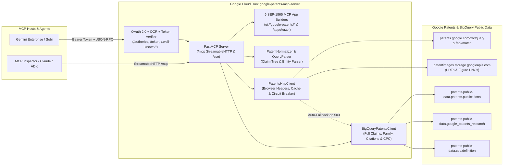

# Google Patents & Interactive IP Workbench MCP Apps Server

An enterprise-grade **Model Context Protocol (MCP) Server** and **Interactive Visual MCP Apps Suite (`SEP-1865`)** for worldwide patent search, claim dependency tree construction, side-by-side claim scope comparison, 20-year statutory lifespan & INPADOC global family analysis, citation & ScaM vector similarity network graphs, white-space portfolio analytics, synchronized patent drawing/PDF inspection, and 2D chemical structure (`SMILES`) discovery on **Google Cloud Run**.

---

## Table of Contents

1. [Overview & Key Capabilities](#1-overview--key-capabilities)
2. [Architecture & Repository Structure](#2-architecture--repository-structure)
3. [Interactive `ui://` MCP Apps (SEP-1865)](#3-interactive-ui-mcp-apps-sep-1865)
4. [Complete Reference of All 18 MCP Tools](#4-complete-reference-of-all-18-mcp-tools)
5. [How to Deploy to Google Cloud Run (Including OAuth 2.0 Setup)](#5-how-to-deploy-to-google-cloud-run-including-oauth-20-setup)
6. [Registering with Gemini Enterprise & Gemini Sobi (`skill/`)](#6-registering-with-gemini-enterprise--gemini-sobi-skill)
7. [How to Use & Test the Tools](#7-how-to-use--test-the-tools)

---

## 1. Overview & Key Capabilities

This server provides **100% feature parity** with [patents.google.com](https://patents.google.com) through a **Universal Dual-Tier Architecture** combined with **6 self-contained SEP-1865 Interactive MCP Apps (`text/html;profile=mcp-app`)**:

* **Dual-Tier Patent Data Engine (Web Gateway + BigQuery Public Datasets)**:
  1. **Google Patents Official Web Gateway & APIs** (`https://patents.google.com/xhr/query` & `/api/match`): Executes ranked keyword/boolean queries, chemical structure (`SMILES`) searches (`EXACT`, `SUBSTRUCTURE`, `SIMILARITY`), ScaM vector similarity discovery, and canonical DOCDB number normalization (`US-10000000-B2`).
  2. **Google BigQuery Public Datasets** (`patents-public-data.patents.publications`, `patents-public-data.google_patents_research.publications`, `patents-public-data.cpc.definition`): Retrieves complete independent/dependent claims text, full specification descriptions, INPADOC international patent families, backward/forward/Scholar Non-Patent Literature (NPL) citation graphs, and official CPC/IPC classification hierarchies—while serving as an automatic high-availability fallback via a built-in circuit breaker.
* **6 Interactive `ui://google-patents/*` MCP Apps (`text/html;profile=mcp-app`)**:
  - **`ui://google-patents/claim-tree`**: 4-tab Claim Dependency Tree, Inherited Limitation Scope Inspector, Side-by-Side Claim Comparator, and Claim Element Chart Matrix.
  - **`ui://google-patents/prior-art-timeline`**: 3-tab Prior Art Cutoff Timeline, 20-Year Statutory Lifespan Bar, Worldwide INPADOC Family Jurisdiction Matrix, and Scholar NPL Inspector.
  - **`ui://google-patents/citation-graph`**: 3-tab Interactive Radial SVG Citation & ScaM Similarity Network Graph with Examiner-Cited (`*`) badges and multi-hop graph re-centering.
  - **`ui://google-patents/landscape-dashboard`**: 3-tab Patent Landscape & White-Space Analytics Dashboard (Top Assignees, Filing Velocity by Year, Jurisdiction Breakdown, and CPC Code Explorer).
  - **`ui://google-patents/pdf-drawing-viewer`**: Synchronized High-Resolution Patent Figure Carousel, Embedded PDF Viewer, and Interactive Specification Reference-Numeral Callout Inspector.
  - **`ui://google-patents/chemistry-explorer`**: 2D Skeletal Molecule SVG Visualizer, Preset Compound & Functional Group Workbench, Physicochemical Property Estimator, and SMILES Substructure Search.
* **Dual-Delivery MCP App Payloads**:
  - Every `open_*_app` tool returns both an inline `EmbeddedResource` (`text/html;profile=mcp-app`) and structured JSON containing `mcp_app_html`, `ui_resource_uri`, and `live_preview_url` so MCP hosts (**Gemini Enterprise**, **Gemini Sobi**, **Claude**, **MCP Inspector**) can render the interactive application immediately on Turn 1.
* **Multi-Tenant OAuth 2.0 + PKCE + Dynamic Client Registration (DCR)**:
  - Built-in RFC 8414 (`/.well-known/oauth-authorization-server`), RFC 9728 (`/.well-known/oauth-protected-resource`), RFC 7591 (`/register`), `/authorize`, and `/token` endpoints with stateless HMAC-SHA256 token signing and Google OAuth 2.0 `tokeninfo` verification.

---

## 2. Architecture & Repository Structure



### Directory Layout

```text
google_patents_mcp_server/
├── Dockerfile                        # Production Python 3.11 Slim container image for Cloud Run
├── deploy.sh                         # Automated Cloud Run deployment & IAM setup script
├── requirements.txt                  # Python dependencies (mcp, google-cloud-bigquery, httpx, starlette, uvicorn)
├── main.py                           # CLI & container entrypoint (--transport streamable-http | sse | stdio)
├── server.py                         # FastMCP server, 18 MCP tools, 6 ui:// resources, OAuth 2.0 & preview routes
├── cli.py                            # Local interactive CLI runner for testing individual patent tools
├── test_local.py                     # End-to-end local verification suite (all tools + 6 ui:// MCP Apps)
├── test_sse.py                       # StreamableHTTP (/mcp), SSE (/sse), and OAuth 2.0 security test suite
├── test_remote.py                    # Remote verification suite against a deployed Cloud Run endpoint
├── mcp_apps/
│   ├── __init__.py                   # Exports all 6 MCP App builders, enrichers, and resource URIs
│   ├── claim_tree_app.py             # App 1: Claim Dependency Tree, Scope Inspector & Comparator
│   ├── timeline_app.py               # App 2: Prior Art Timeline, 20-Year Lifespan & INPADOC Family Map
│   ├── citation_graph_app.py         # App 3: Interactive Citation & ScaM Similarity Network Graph
│   ├── landscape_app.py              # App 4: Patent Landscape & White-Space Analytics Dashboard
│   ├── pdf_viewer_app.py             # App 5: Synchronized Drawing Carousel & PDF Split-Viewer
│   └── chemistry_app.py              # App 6: 2D Chemical Structure / SMILES Explorer Workbench
├── services/
│   ├── __init__.py
│   ├── bigquery_client.py            # BigQuery client for publications, google_patents_research & cpc.definition
│   ├── patents_http_client.py        # Google Patents XHR gateway client with cookie/header emulation
│   ├── circuit_breaker.py            # Fail-fast circuit breaker & in-memory TTL cache
│   ├── normalizer.py                 # Canonical DOCDB publication number normalizer
│   └── query_parser.py               # Freeform query & entity/SMILES/measure parser
└── skill/
    ├── SKILL.md                      # Sanitized companion skill for Gemini Enterprise / Sobi agents
    └── google_patents_mcp_skill.zip  # Ready-to-upload skill archive (after filling in project placeholders)
```

---

## 3. Interactive `ui://` MCP Apps (SEP-1865)

All 6 MCP Apps are 100% self-contained HTML5/CSS/SVG/JS bundles (`mimeType: "text/html;profile=mcp-app"`) that communicate with the MCP host via the **SEP-1865 JSON-RPC 2.0 `postMessage` bridge** (`ui/initialize`, `ui/notifications/tool-result`, `tools/call`, `ui/open-link`, `ui/message`) and fall back to built-in `/apps/api/*` endpoints when opened directly in a browser tab.

### App 1: Claim Dependency Tree, Scope Inspector & Side-by-Side Comparator (`ui://google-patents/claim-tree`)
* **Tab 1 — Collapsible Claim Dependency Tree & Inherited Scope**: Parses every independent and dependent claim, builds a hierarchical dependency tree (`parent_claim_numbers`, `ancestor_chain`, `depth`), decomposes claims into preamble + clause limitations, and computes the **Full Effective Claim Scope** by merging all inherited ancestor limitations.
* **Tab 2 — Side-by-Side Claim Comparator**: Compares any two patents side-by-side (e.g., `US8000000B2` vs. `US10000000B2`), highlights overlapping technical vocabulary chips, and triggers one-click AI claim differentiation.
* **Tab 3 — Claim Element Chart Matrix**: Interactive claim construction & infringement/invalidity element chart with Markdown table export.
* **Tab 4 — Patent Bibliographic Dossier**: Full abstract, assignees, inventors, CPC classifications, and key dates.

### App 2: Prior Art Timeline, 20-Year Lifespan & INPADOC Family Map (`ui://google-patents/prior-art-timeline`)
* **Tab 1 — Priority Cutoff & 20-Year Statutory Lifespan**: Visualizes earliest priority date, filing date, publication date, grant date, estimated 20-year statutory expiration, and chronological prior-art milestones (`backward_citation`, `priority`, `filing`, `grant`).
* **Tab 2 — Global INPADOC Family Jurisdiction Matrix**: Breaks down worldwide family filings by country code (`US`, `EP`, `WO`, `CN`, `JP`, `KR`, etc.) with click-to-filter jurisdiction cards.
* **Tab 3 — Google Scholar & Non-Patent Literature (NPL) Inspector**: Lists scientific papers and non-patent literature cited during prosecution.

### App 3: Interactive Citation & ScaM Similarity Network Graph (`ui://google-patents/citation-graph`)
* **Tab 1 — Directed Radial SVG Network Graph**: Interactive node-link graph uniting Backward Citations (Prior Art), Forward Citations (Citing Patents), and ScaM Vector-Similar Patents around the target patent, with Examiner-Cited (`★`) badges and one-click **Re-Center & Hop Graph** navigation.
* **Tab 2 — Citation Matrix Table**: Filterable table of backward, forward, and similar patents with Examiner-only toggle.
* **Tab 3 — Non-Patent Literature (NPL) Citations**: Full list of cited literature references.

### App 4: Patent Landscape & White-Space Analytics Dashboard (`ui://google-patents/landscape-dashboard`)
* **Tab 1 — Executive Landscape Analytics**: Top Assignees horizontal bar chart, Filing/Publication Velocity by Year histogram, Jurisdiction breakdown pills, and Top CPC/IPC classification distribution—all supporting interactive click-to-filter slicing.
* **Tab 2 — Patent Portfolio Grid**: Searchable patent cards with figure thumbnails, snippets, and direct links to the Sandbox-Safe Patent Reader and PDF.
* **Tab 3 — CPC / IPC Classification Explorer**: Live classification hierarchy and definition lookup (`patents-public-data.cpc.definition`).

### App 5: Synchronized Drawing Carousel, PDF & Specification Split-Viewer (`ui://google-patents/pdf-drawing-viewer`)
* **Left Pane — High-Resolution Drawing Sheet Carousel & Embedded PDF**: Pre-fetches and embeds official patent drawing sheets with zoom (`50%`–`250%`), `90°` rotation, and an embedded PDF viewer mode.
* **Right Pane — Synchronized Specification Callouts & Claims**: Extracts `FIG. 1`, `FIG. 2`, etc. paragraphs and reference numerals from the specification and auto-scrolls to the matching description passages as you flip through drawing sheets.

### App 6: 2D Chemical Structure / SMILES Explorer & Substructure Workbench (`ui://google-patents/chemistry-explorer`)
* **Interactive 2D Skeletal Molecule SVG Renderer**: Client-side SMILES parser and ring-closure layout engine with CPK heteroatom coloring (`O`=Red, `N`=Blue, `S`=Amber, `F/Cl`=Green).
* **Preset Library & Functional Group Appender**: One-click presets (Aspirin, Ibuprofen, Paracetamol, Caffeine, Ethylene Carbonate, Sulfanilamide), functional group chips (`-COOH`, `-OH`, `-NH2`, `-CF3`, Phenyl, Ester), Lipinski Rule-of-5 property cards, and live `EXACT` / `SUBSTRUCTURE` / `SIMILARITY` chemical patent search.

---

## 4. Complete Reference of All 18 MCP Tools

| # | Tool Name | Category | Linked `ui://` Resource | Description |
|---|---|---|---|---|
| 1 | `open_patent_claim_tree_app` | Interactive MCP App | `ui://google-patents/claim-tree` | Launches the 4-tab Claim Dependency Tree, Scope Inspector & Side-by-Side Comparator (`EmbeddedResource` + JSON). |
| 2 | `open_prior_art_timeline_app` | Interactive MCP App | `ui://google-patents/prior-art-timeline` | Launches the 3-tab Prior Art Timeline, 20-Year Lifespan & INPADOC Family Map (`EmbeddedResource` + JSON). |
| 3 | `open_patent_citation_graph_app` | Interactive MCP App | `ui://google-patents/citation-graph` | Launches the 3-tab Citation & ScaM Similarity Radial Network Graph (`EmbeddedResource` + JSON). |
| 4 | `open_patent_landscape_app` | Interactive MCP App | `ui://google-patents/landscape-dashboard` | Launches the 3-tab Patent Landscape & White-Space Analytics Dashboard (`EmbeddedResource` + JSON). |
| 5 | `open_patent_pdf_viewer_app` | Interactive MCP App | `ui://google-patents/pdf-drawing-viewer` | Launches the Synchronized Drawing Carousel, PDF & Specification Split-Viewer (`EmbeddedResource` + JSON). |
| 6 | `open_chemistry_explorer_app` | Interactive MCP App | `ui://google-patents/chemistry-explorer` | Launches the 2D Chemical Structure / SMILES Explorer & Substructure Workbench (`EmbeddedResource` + JSON). |
| 7 | `advanced_patent_search` | Search & Discovery | `ui://google-patents/landscape-dashboard` | Multi-filter structured patent search by keywords, assignee, inventor, CPC/IPC code, country, status, and date range. |
| 8 | `search_patents` | Search & Discovery | `ui://google-patents/landscape-dashboard` | Quick keyword, boolean, measure-range, or URL-parameter search (`query_url_or_params`). |
| 9 | `search_chemistry` | Search & Discovery | `ui://google-patents/chemistry-explorer` | Chemical structure search (`SMILES` / `InChIKey`) supporting `EXACT`, `SUBSTRUCTURE`, and `SIMILARITY` modes. |
| 10 | `get_patent_details` | Patent Dossier & Claims | `ui://google-patents/claim-tree` | Full bibliographic details, abstract, assignees, inventors, independent/dependent claims, and parsed `claims_tree`. |
| 11 | `get_prior_art_timeline` | Family & Prior Art | `ui://google-patents/prior-art-timeline` | Chronological prior art timeline, priority/filing/grant/expiry dates, INPADOC global family, and Scholar NPL citations. |
| 12 | `get_patent_citations` | Citations & Similarity | `ui://google-patents/citation-graph` | Backward (cited prior art), forward (citing patents), and Non-Patent Literature (NPL) citation graph. |
| 13 | `find_similar_patents` | Citations & Similarity | `ui://google-patents/citation-graph` | Finds technically similar patents using Google's ScaM / PatentSimilarity vector embeddings and CPC overlap. |
| 14 | `get_patent_pdf` | Media & Drawings | `ui://google-patents/pdf-drawing-viewer` | Retrieves direct GCS PDF download URL, high-resolution figure drawing sheets, and specification figure callouts. |
| 15 | `lookup_classification_code` | Classification | `ui://google-patents/landscape-dashboard` | Looks up official CPC / IPC classification titles, hierarchical definitions, and parent trees from BigQuery. |
| 16 | `parse_query` | Utility | *(Data only)* | Parses freeform queries for patent numbers, assignees, dates, or SMILES tokens and recommends the optimal MCP tool. |
| 17 | `normalize_patent_number` | Utility | *(Data only)* | Normalizes raw or ambiguous patent numbers (e.g., `"10000000"`) into canonical DOCDB format (`"US-10000000-B2"`). |
| 18 | `set_patents_session_cookie` | Session Utility | *(Data only)* | Dynamically injects or updates Google Patents browser session cookies (`NID`, `SOCS`) at runtime without restart. |

### Tool Parameter Details

#### 1. `open_patent_claim_tree_app`
* `patent_url_or_id` *(str, required)*: Primary patent publication number or URL (e.g., `"US8000000B2"`, `"US11435904B1"`).
* `compare_with_patent_id` *(Optional[str], default `""`)*: Optional second patent ID for immediate side-by-side claim comparison.

#### 2. `open_prior_art_timeline_app`
* `patent_id` *(str, required)*: Patent publication number (e.g., `"US8000000B2"`).

#### 3. `open_patent_citation_graph_app`
* `patent_id` *(str, required)*: Target patent publication number (e.g., `"US8000000B2"`).
* `include_similar` *(bool, default `True`)*: Also fetch ScaM vector-similar patents and merge them into the network graph.
* `limit` *(int, default `20`)*: Maximum citations per direction (`1` to `50`).

#### 4. `open_patent_landscape_app`
* `query` *(str, default `""`)*: Keywords or technical phrase (e.g., `"solid state electrolyte"`).
* `assignee` *(str, default `""`)*: Assignee/company filter (e.g., `"Toyota"`, `"Waymo"`).
* `cpc_code` *(str, default `""`)*: CPC classification prefix (e.g., `"H01M"`, `"G06N"`).
* `country_code` *(str, default `""`)*: 2-letter jurisdiction code (`"US"`, `"EP"`, `"WO"`, `"JP"`, `"CN"`, `"KR"`).
* `start_date` / `end_date` *(str, default `""`)*: Date filter (`"YYYY-MM-DD"`).
* `limit` *(int, default `20`)*: Maximum patents to analyze (`1` to `50`).

#### 5. `open_patent_pdf_viewer_app`
* `patent_id` *(str, required)*: Patent publication number (e.g., `"US8000000B2"`).

#### 6. `open_chemistry_explorer_app`
* `smiles` *(str, default `"CC(=O)Oc1ccccc1C(=O)O"`)*: Chemical structure in SMILES format.
* `mode` *(`"EXACT"` | `"SUBSTRUCTURE"` | `"SIMILARITY"`, default `"SUBSTRUCTURE"`)*: Structure match mode.
* `query` *(str, default `""`)*: Additional keyword filter.
* `limit` *(int, default `15`)*: Maximum matching chemical patents (`1` to `50`).

#### 7. `advanced_patent_search`
* `query` *(str, default `""`)*: Search keywords or boolean query.
* `cpc_code` / `ipc_code` *(str, default `""`)*: CPC or IPC classification code filter.
* `country_code` *(str, default `""`)*: 2-letter country/jurisdiction code (`"US"`, `"EP"`, `"WO"`, etc.).
* `start_date` / `end_date` *(str, default `""`)*: Priority/filing date range (`"YYYY-MM-DD"` or `"YYYYMMDD"`).
* `assignee` *(str, default `""`)*: Assignee / company name.
* `inventor` *(str, default `""`)*: Inventor name.
* `status` *(str, default `""`)*: `"GRANT"` or `"APPLICATION"`.
* `limit` *(int, default `10`)*: Maximum results (`1` to `50`).

#### 8. `search_patents`
* `query_url_or_params` *(str, required)*: Freeform search query (e.g., `"autonomous vehicle lidar"`) or URL query string (`"q=solid+state+battery&assignee=Toyota"`).
* `limit` *(int, default `10`)*: Maximum results (`1` to `50`).

#### 9. `search_chemistry`
* `smiles` *(str, required)*: SMILES string (e.g., `"CC(=O)Oc1ccccc1C(=O)O"`) or InChIKey.
* `mode` *(`"EXACT"` | `"SUBSTRUCTURE"` | `"SIMILARITY"`, default `"EXACT"`)*: Chemical search mode.
* `query` *(str, default `""`)*: Optional keyword filter.
* `limit` *(int, default `10`)*: Maximum results (`1` to `50`).

#### 10. `get_patent_details`
* `patent_url_or_id` *(str, required)*: Patent publication number (e.g., `"US8000000B2"`, `"US-11435904-B1"`).
* `include_claims` *(bool, default `True`)*: Include full independent/dependent claims and parsed `claims_tree`.
* `include_description` *(bool, default `False`)*: Include full specification description text.

#### 11–18. `get_prior_art_timeline`, `get_patent_citations`, `find_similar_patents`, `get_patent_pdf`, `lookup_classification_code`, `parse_query`, `normalize_patent_number`, `set_patents_session_cookie`
* `get_prior_art_timeline(patent_id)`: Extracts priority/filing/grant/expiration timeline, INPADOC family, and Scholar NPL.
* `get_patent_citations(patent_id, citation_type="both", limit=25)`: Extracts backward, forward, and NPL citations.
* `find_similar_patents(patent_id, limit=10)`: Finds vector-similar patents via ScaM / BigQuery embeddings.
* `get_patent_pdf(patent_id)`: Returns direct GCS PDF URL, drawing sheet URLs, and specification figure callouts.
* `lookup_classification_code(code)`: Looks up official CPC/IPC symbol definitions (e.g., `"G06N3/08"`).
* `parse_query(query)` & `normalize_patent_number(number, country="US", patent_type="patent")`: Query analysis & DOCDB normalization.

---

## 5. How to Deploy to Google Cloud Run (Including OAuth 2.0 Setup)

### Prerequisites
1. Google Cloud SDK (`gcloud`) installed and authenticated.
2. A Google Cloud Project with **Cloud Run**, **Cloud Build**, **Artifact Registry**, and **BigQuery** APIs enabled:
   ```bash
   export PROJECT_ID="your-gcp-project-id"
   export REGION="us-central1"
   export SERVICE_NAME="google-patents-mcp-server"

   gcloud config set project "${PROJECT_ID}"
   ```

---

### Option A: One-Command Automated Deployment (`./deploy.sh`)

The included [`deploy.sh`](./deploy.sh) script automatically enables required APIs, grants the Cloud Run runtime service account `roles/bigquery.jobUser` and `roles/bigquery.dataViewer` (required to query Google's `patents-public-data` public datasets), deploys the container to Cloud Run, and outputs the Gemini Enterprise OAuth 2.0 endpoints:

```bash
export PROJECT_ID="your-gcp-project-id"
export REGION="us-central1"
export GOOGLE_OAUTH_CLIENT_ID="YOUR_GOOGLE_OAUTH_CLIENT_ID"
export GOOGLE_OAUTH_CLIENT_SECRET="YOUR_GOOGLE_OAUTH_CLIENT_SECRET"

./deploy.sh
```

---

### Option B: Manual Cloud Run Deployment with Google Cloud Secret Manager

1. **Create an OAuth 2.0 Web Application Client ID in Google Cloud Console**:
   - Navigate to **APIs & Services > Credentials > Create Credentials > OAuth client ID**.
   - Select **Web application** and add the Gemini Enterprise OAuth redirect URI:
     ```text
     https://vertexaisearch.cloud.google.com/oauth-redirect
     ```
2. **Store OAuth Credentials in Secret Manager**:
   ```bash
   printf "%s" "YOUR_GOOGLE_OAUTH_CLIENT_ID" | \
     gcloud secrets create mcp-oauth-client-id --data-file=- --replication-policy="automatic"

   printf "%s" "YOUR_GOOGLE_OAUTH_CLIENT_SECRET" | \
     gcloud secrets create mcp-oauth-client-secret --data-file=- --replication-policy="automatic"
   ```
3. **Deploy to Cloud Run**:
   ```bash
   gcloud run deploy "${SERVICE_NAME}" \
     --source . \
     --region "${REGION}" \
     --allow-unauthenticated \
     --memory=1Gi \
     --cpu=1 \
     --min-instances=0 \
     --max-instances=5 \
     --session-affinity \
     --set-env-vars="GOOGLE_CLOUD_PROJECT=${PROJECT_ID},MCP_TRANSPORT=streamable-http,REQUIRE_OAUTH=true" \
     --set-secrets="GOOGLE_OAUTH_CLIENT_ID=mcp-oauth-client-id:latest,GOOGLE_OAUTH_CLIENT_SECRET=mcp-oauth-client-secret:latest"
   ```
4. **Set `MCP_PUBLIC_BASE_URL` (Optional — also auto-detected from request headers)**:
   ```bash
   SERVICE_URL=$(gcloud run services describe "${SERVICE_NAME}" --region "${REGION}" --format="value(status.url)")
   gcloud run services update "${SERVICE_NAME}" \
     --region "${REGION}" \
     --update-env-vars="MCP_PUBLIC_BASE_URL=${SERVICE_URL},MCP_RESOURCE_SERVER_URL=${SERVICE_URL}/mcp"
   ```

---

### Verify Health & OAuth Discovery Endpoints

```bash
# 1. Health, Registered MCP Apps & Circuit Breaker Status
curl -s "${SERVICE_URL}/healthz" | jq .

# 2. OAuth 2.0 Authorization Server Metadata (RFC 8414)
curl -s "${SERVICE_URL}/.well-known/oauth-authorization-server" | jq .

# 3. OAuth 2.0 Protected Resource Metadata (RFC 9728)
curl -s "${SERVICE_URL}/.well-known/oauth-protected-resource" | jq .
```

---

## 6. Registering with Gemini Enterprise & Gemini Sobi (`skill/`)

### 6.1 Registering the MCP Server in Gemini Enterprise
Register the deployed Cloud Run service in Gemini Enterprise (**Discovery Engine**) as a BYO Custom MCP (`custom_mcp`) connector:

```bash
export GE_PROJECT_ID="your-gemini-enterprise-project-id"
export GE_PROJECT_NUMBER=$(gcloud projects describe "${GE_PROJECT_ID}" --format="value(projectNumber)")
export COLLECTION_ID="google-patents-mcp"
export OAUTH_CLIENT_ID="YOUR_GOOGLE_OAUTH_CLIENT_ID"
export OAUTH_CLIENT_SECRET="YOUR_GOOGLE_OAUTH_CLIENT_SECRET"

TOKEN=$(gcloud auth application-default print-access-token 2>/dev/null || gcloud auth print-access-token)

curl -s -X POST \
  -H "Authorization: Bearer ${TOKEN}" \
  -H "X-Goog-User-Project: ${GE_PROJECT_NUMBER}" \
  -H "Content-Type: application/json" \
  "https://preprod-discoveryengine.googleapis.com/v1alpha/projects/${GE_PROJECT_NUMBER}/locations/global:setUpDataConnectorV2?collectionId=${COLLECTION_ID}&collectionDisplayName=Google%20Patents%20MCP" \
  -d "{
    \"dataSource\": \"custom_mcp\",
    \"refreshInterval\": \"86400s\",
    \"entities\": [{\"entityName\": \"mcp_data\"}],
    \"params\": {
      \"oauth_access_token\": \"\",
      \"auth_type\": \"AUTHORIZATION_TYPE_UNDEFINED\"
    },
    \"destinationConfigs\": [{
      \"key\": \"instance_uri\",
      \"destinations\": [{\"host\": \"${SERVICE_URL}/mcp\"}]
    }],
    \"connectorModes\": [\"FEDERATED\", \"ACTIONS\"],
    \"actionConfig\": {
      \"actionParams\": {
        \"instance_uri\": \"${SERVICE_URL}/mcp\",
        \"auth_uri\": \"${SERVICE_URL}/authorize\",
        \"auth_uri_params\": \"&access_type=offline&prompt=consent\",
        \"token_uri\": \"${SERVICE_URL}/token\",
        \"client_id\": \"${OAUTH_CLIENT_ID}\",
        \"client_secret\": \"${OAUTH_CLIENT_SECRET}\",
        \"scopes\": \"openid email profile\",
        \"auth_type\": \"OAUTH\",
        \"auth_key\": \"OAuth\",
        \"mcp_server_source\": \"BYO_MCP\"
      },
      \"isActionConfigured\": true,
      \"createBapConnection\": true
    },
    \"bapConfig\": {
      \"supportedConnectorModes\": [\"ACTIONS\"]
    }
  }"
```

### 6.2 Onboarding the Companion Skill (`skill/SKILL.md`) in Gemini Sobi
The [`skill/`](./skill/) directory contains the companion skill ([`skill/SKILL.md`](./skill/SKILL.md)) for Gemini Sobi agents:
1. Open [`skill/SKILL.md`](./skill/SKILL.md) and replace:
   - `<YOUR_PROJECT_NUMBER>` with your numeric Google Cloud project number.
   - `<YOUR_CLOUD_RUN_SERVICE_URL>` with your deployed Cloud Run hostname (e.g., `google-patents-mcp-server-xxxxxx-uc.a.run.app`).
2. Re-package `SKILL.md` into `google_patents_mcp_skill.zip`:
   ```bash
   cd skill && zip -q -r google_patents_mcp_skill.zip SKILL.md && cd ..
   ```
3. Upload `google_patents_mcp_skill.zip` as a Skill in Gemini Enterprise / Sobi and attach both the Skill and the `google-patents-mcp` MCP server to your agent.

---

## 7. How to Use & Test the Tools

### 7.1 Running Locally for Development

```bash
# Create virtual environment and install dependencies
python3 -m venv .venv
source .venv/bin/activate
pip install -r requirements.txt

# Set your GCP project for BigQuery public dataset queries and start on port 8080
export GOOGLE_CLOUD_PROJECT="your-gcp-project-id"
export REQUIRE_OAUTH="false"
python3 main.py --transport streamable-http --port 8080
```

### 7.2 Interactive Browser Previews (`/apps/raw/*`)
While running locally (or on Cloud Run), you can test all 6 interactive SEP-1865 MCP Apps directly in your browser:
* **App 1 — Claim Dependency Tree & Comparator**:
  - `http://localhost:8080/apps/raw/claim-tree?patent_id=US8000000B2&compare_id=US10000000B2`
* **App 2 — Prior Art Timeline & INPADOC Family Map**:
  - `http://localhost:8080/apps/raw/prior-art-timeline?patent_id=US8000000B2`
* **App 3 — Interactive Citation & ScaM Similarity Network Graph**:
  - `http://localhost:8080/apps/raw/citation-graph?patent_id=US8000000B2`
* **App 4 — Patent Landscape & White-Space Analytics Dashboard**:
  - `http://localhost:8080/apps/raw/landscape-dashboard?q=solid+state+electrolyte&assignee=Toyota`
* **App 5 — Synchronized Drawing Carousel & PDF Split-Viewer**:
  - `http://localhost:8080/apps/raw/pdf-drawing-viewer?patent_id=US8000000B2`
* **App 6 — 2D Chemical Structure / SMILES Explorer**:
  - `http://localhost:8080/apps/raw/chemistry-explorer?smiles=CC(=O)Oc1ccccc1C(=O)O`

### 7.3 Automated Test Suites & CLI Runner

```bash
# 1. Run full local verification suite (all tools + all 6 ui:// MCP Apps)
python3 test_local.py

# 2. Run StreamableHTTP (/mcp), SSE (/sse), and OAuth 2.0 security verification suite
python3 test_sse.py

# 3. Quick CLI tool runner
python3 cli.py details US8000000B2 --claims
python3 cli.py advanced --query "noise cancellation" --assignee "Bose" --cpc "G10K"
```

### 7.4 Sample Natural Language Prompts for Gemini Enterprise

* **Claim Dependency Tree & Side-by-Side Comparison (`open_patent_claim_tree_app`)**:
  > *"Open the interactive Claim Dependency Tree and Scope Inspector for US8000000B2 and compare its independent claims side-by-side against US10000000B2."*
* **Prior Art Timeline & Worldwide INPADOC Family (`open_prior_art_timeline_app`)**:
  > *"Launch the Prior Art Timeline and INPADOC Worldwide Patent Family map for US11435904B1 and analyze its priority cutoff date and 20-year statutory lifespan."*
* **Citation & ScaM Vector Similarity Graph (`open_patent_citation_graph_app`)**:
  > *"Open the interactive Citation & Similarity Network Graph for US8000000B2 including ScaM vector-similar patents, and identify which backward citations were cited by the USPTO examiner."*
* **Patent Landscape & White-Space Dashboard (`open_patent_landscape_app`)**:
  > *"Open the Patent Landscape Dashboard for 'solid state electrolyte' patents assigned to Toyota in the US and summarize the top CPC classification codes and filing velocity."*
* **Synchronized Drawing Carousel & PDF Split-Viewer (`open_patent_pdf_viewer_app`)**:
  > *"Open the Patent Drawing & PDF Split-Viewer for US8000000B2 so I can inspect the figure sheets alongside the specification callouts."*
* **2D Chemical Structure / SMILES Substructure Search (`open_chemistry_explorer_app`)**:
  > *"Open the 2D Chemistry Explorer for Aspirin (`CC(=O)Oc1ccccc1C(=O)O`) in SUBSTRUCTURE mode and find matching pharmaceutical patents."*
