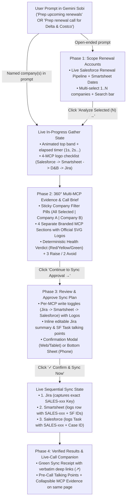
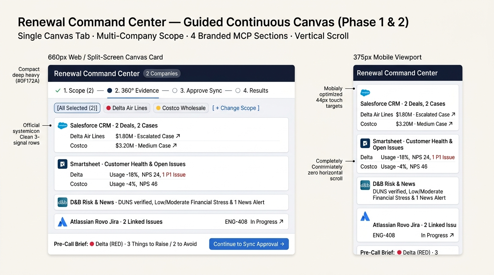
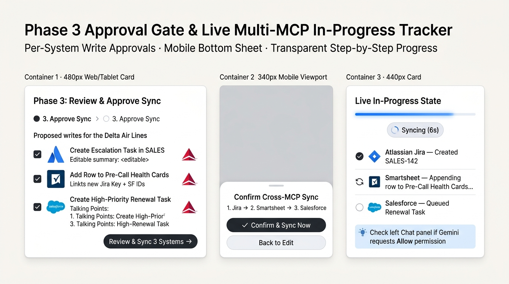
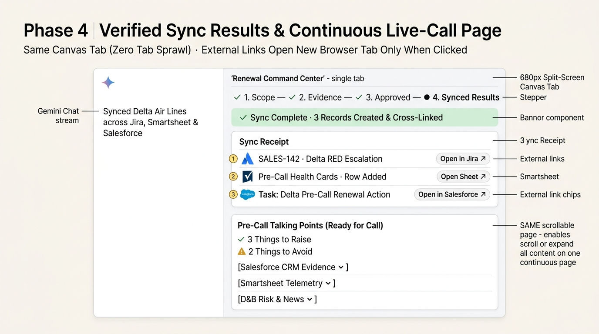

# Renewal Command Center (`nyc-renewal-command-center-a2ui`) — Guided 4-MCP A2UI v0.9 Canvas UX Design

> **Design Status:** Approved & Implemented A2UI v0.9 Canvas Architecture
> **Target Runtime:** Gemini Enterprise (`Sobi` Sandbox + A2UI v0.9 Composite Catalog)
> **Base Workflow Enhanced:** `nyc-renewal-command-center`
> **A2UI Delivery Mode:** A2UI v0.9 `Canvas` $\rightarrow$ `IFrameSrcdoc` Synthesis Mode (`surfaceId: "nyc_renewal_command_center"`, `autoOpen: true`, `autoFullscreen: false`)

---

## 1. Analysis of `nyc-renewal-command-center` & Connected MCP Servers

### 1.1 Connected 4-MCP Ecosystem in Gemini Enterprise

| System & Brand | Registered DataConnector (`projects/<PROJECT_NUMBER>/locations/global/...`) | MCP Endpoint | Read Tools Used (Phase 1 & 2) | Write Tools Used (Phase 3 -> 4) |
| :--- | :--- | :--- | :--- | :--- |
| **Salesforce CRM** | `collections/<salesforce-mcp-connector>/dataConnector` | `https://api.salesforce.com/platform/mcp/v1/platform/sobject-all` | `soqlQuery` (`Account`, `Opportunity`, `Case`, `Contact`), `getUserInfo` | `createSobjectRecord` (`Task` linked via `WhatId` to Opportunity/Account) |
| **Smartsheet** | `collections/<smartsheet-mcp-server>/dataConnector` | `https://mcp.smartsheet.com` | `execute_workspaces_read` (`Customer Health`, `Customer Open Issues`), `get_columns`, `get_sheet_summary`, `find_in_sheet` | `add_rows` into `Pre-Call Health Cards` (Health Rating, Deciding Rule, Jira Key, SF IDs) |
| **Dun & Bradstreet (D&B)** | `collections/<d-b-connector>/dataConnector` | `https://plus.dnb.com/v2/mcp` | `MatchTool` (`countryISOAlpha2Code: "US"`, `strict_match: false`) $\rightarrow$ `RiskTool` + `NewsTool` | *(Read-only external commercial risk & news intelligence)* |
| **Atlassian Rovo Jira** | `collections/<atlassian-rovo-jira-mcp-server>/dataConnector` | `https://mcp.atlassian.com/v1/mcp` | `getAccessibleAtlassianResources` (`cloudId`, site URL) $\rightarrow$ `searchJiraIssuesUsingJql` | `createJiraIssue` in `SALES` (`Task`) for `Red` / `Yellow` renewals |

### 1.2 Gaps in a Text-Only Skill & How the Canvas UX Solves Them

1. **Flat Text Wall vs. Guided Phase-by-Phase Journey:** Today, Phase 1 dumps CRM, Smartsheet, D&B, and Jira outputs into a single long Markdown chat message and asks the user to type `"Sync it"`. Moving to a **4-Phase Guided Canvas Page** turns this into a structured, visual step-by-step journey (`1. Scope` $\rightarrow$ `2. 360° Evidence` $\rightarrow$ `3. Approve Sync` $\rightarrow$ `4. Results`).
2. **Single-Company Assumption vs. Multi-Company Renewal Batches:** Today's SOQL/JQL instructions assume a single `<Customer>` string. Our UX introduces **Phase 1 Portfolio Scoping** (select 1 or multiple upcoming renewals) and **dynamic per-MCP sections** that cleanly group and scale across 1..N selected companies.
3. **Blended Data Attribution vs. Branded MCP Sections:** In chat text, CRM cases, Smartsheet P1 rows, D&B scores, and Jira issues blur together. In the Canvas, **each MCP renders inside its own distinct section card anchored by its official inline SVG brand logo** and record provenance pills.
4. **All-or-Nothing `"Sync it"` vs. Granular Per-System Approvals:** Instead of a blind chat confirmation, **Phase 3** lets users review, edit talking points/summaries, and toggle individual writes across Jira, Smartsheet, and Salesforce before confirming via a clean Modal (desktop/tablet) or **Thumb-Zone Bottom Sheet** (mobile).
5. **Silent Multi-MCP Wait Times vs. Transparent Live Progress:** Querying 4 MCPs or writing sequentially across 3 MCPs takes 8–20s. Our design introduces a **live animated activity band + elapsed timer + per-MCP logo progress checklist** (plus split-screen `Allow` permission awareness).

---

## 2. Core UX Architecture & Design Principles

### 2.1 Zero Tab Sprawl — One Continuous Vertical Canvas Page
* **Single Deterministic `surfaceId` (`"nyc_renewal_command_center"`):** Every action—scoping companies, gathering 4-MCP evidence, filtering between selected companies, approving writes, and viewing final sync receipts—updates the **exact same right-hand Canvas tab** in place.
* **When External Tabs Open (`↗`):** Separate browser tabs (`target="_blank"`) open **only** when the user explicitly clicks a verbatim external record chip (`Open Deal in Salesforce ↗`, `Open Sheet in Smartsheet ↗`, `Open SALES-142 in Jira ↗`).
* **Continuous Vertical Growth & Accordion Memory:** Rather than hiding earlier steps behind disconnected tabs, the Canvas grows vertically as data expands. Completed phases collapse into compact 1-line summary bars (`✓ Phase 1: 2 Companies Scoped · Change ▾`) while keeping all 4 MCP sections and the Pre-Call Brief scrollable on a single continuous page.

### 2.2 Multi-Form-Factor Responsive Matrix (Web, Tablet, Mobile)

| Form Factor | Viewport | Layout & Minimalism Rules | Touch, Scroll & Confirmation Behavior |
| :--- | :--- | :--- | :--- |
| **Mobile Phone** | `320px – 580px` | • Single-column full-width card (`12px` outer padding, **zero horizontal scroll**) • Compact `48px` header (`Renewal Command Center` + live status pill) • **`font-size: 16px`** on all inputs/textareas (prevents iOS Safari tap zoom) • **`min-height: 44px`** on all checkboxes, pills, and action buttons | • Swipeable horizontal Phase Stepper & Company Filter chips (`scrollbar-width: none`) • Vertical page scroll for multi-company MCP sections • **Thumb-Zone Mobile Bottom Sheet** (`border-radius: 20px 20px 0 0`) for Phase 3 write confirmation |
| **Gemini Split-Screen & Tablet** *(Default)* | `581px – 840px` | • `autoFullscreen: false` keeps left-hand Gemini Chat (`Allow`/`Deny` MCP tool prompts) visible beside the Canvas • Centered `660px` single-column stack on `#F6F7F9` neutral canvas | • `0ms` client-side company filter pills (`All Selected (N)` vs. single company) • Centered `440px` Confirmation Modal + `window.blur` auto-clear when `Allow` is clicked in Chat |
| **Desktop Web** | `841px+` | • Centered `680px` calm container so eye travel stays minimal even on wide monitors | • Full keyboard navigation (`Tab`, visible focus ring, `Esc` modal dismiss) |

---

## 3. End-to-End 4-Phase Guided User Journey

---

### Phase 1 — Scope Renewal Accounts (`1. Scope`)

* **When Shown Full-View:** Triggered when the user asks an open-ended question (*"Open Renewal Command Center"*, *"Check my Q4 renewals"*), or when the user taps **`[+ Change Scope]`** from Phase 2. *(If the user names specific companies like `"Prepare for my renewal call with Delta Air Lines"`, Phase 1 auto-completes into a compact `✓ 1. Scope (Delta Air Lines · + Add)` header and lands directly in Phase 2.)*
* **What Appears on Page:**
  1. **Search & Quick Filter Bar:** Search any account name (`16px` mobile-safe input) or tap filter chips (`Closing < 60d`, `At-Risk Signals`, `All Open Renewals`).
  2. **Multi-Select Renewal Cards (with Salesforce + Smartsheet Provenance Badges):**
     * Each selectable card (`min-height: 48px` checkbox row) shows: **`[✓] Company Name`**, **Renewal Amount (`$1.80M`)**, **Close / Renewal Date**, and a preliminary **Stage pill** (`Negotiation`).
  3. **Sticky Bottom Action Footer:** **`Analyze Selected Renewals (2) →`**.

---

### Phase 2 — 360° Multi-MCP Health Evidence & Pre-Call Brief (`2. 360° Evidence`)

#### Sticky Multi-Company Filter Bar *(Rendered automatically when `Selected Companies >= 2`)*
* Horizontal swipeable pill strip right below the Phase Stepper:
  **`[ All Selected (2) ]` · `[ 🔴 Delta Air Lines ]` · `[ 🟡 Costco Wholesale ]` · `[ + Change Scope ]`**
* **Default (`All Selected`):** Every MCP section below dynamically renders clean sub-groups for each selected company, growing vertically down the page.
* **Single-Company Focus (`0ms` local switch):** Tapping `[ 🔴 Delta Air Lines ]` filters all 4 MCP sections and the Pre-Call Brief instantly to just Delta Air Lines with zero network latency.

#### Four Separated, Branded, Dynamically-Scaling MCP Sections
Each system's data lives in its own dedicated white card with a subtle `3px` brand-colored left accent border, an **embedded inline SVG logo** (sandbox-safe with zero external image requests), a clear system title, and dynamic record rows:

1. **Section 1 — Salesforce CRM (`#00A1E0` Cloud Logo · `#0176D3` Accent)**
   * **Header:** `[Salesforce Cloud Logo] Salesforce CRM` + live badge (`2 Deals · 2 Open Cases`)
   * **Dynamic Per-Company Content:**
     * **Renewal Opportunity Row(s):** Opportunity Name, `StageName` pill, `$Amount`, `CloseDate`, `NextStep`, and verbatim **`Deal ↗`** link (`https://<your-domain>.my.salesforce.com/<18_CHAR_ID>`). Supports multiple open opportunities per company seamlessly.
     * **Support Case Row(s):** `CaseNumber`, `Subject`, semantic `Priority` / `Status` pill (`Escalated` / `High` in red; `Medium` in amber), and verbatim **`Case ↗`** link.
     * **Progressive Disclosure:** **`Executive Contacts (N) ▾`** expands vertically to list `Name · Title · Email` without cluttering the initial scan.

2. **Section 2 — Smartsheet Usage & Issue Trackers (`Smartsheet Grid-Star Logo` · `#2D60D7` Accent)**
   * **Header:** `[Smartsheet Logo] Smartsheet` + provenance badge (`Customer Health · Open Issues ↗`)
   * **Dynamic Per-Company Content:**
     * **Telemetry Strip:** `MAU` · `90d Usage Trend` (`-18%` red pill if `< -15%`; amber if `< 0%`; green if `>= 0%`) · `NPS` (`24` red if `< 30`; amber if `< 50`) · `Renewal Date`.
     * **Open Tracker Issues List:** Dynamically lists all matching rows from `Customer Open Issues` (`P1` / `P2` badge, summary, days open). Displays a calm `✓ No open tracker issues` line if zero exist.

3. **Section 3 — Dun & Bradstreet Commercial Risk (`d&b` Square Logo · `#0057B8` Accent)**
   * **Header:** `[d&b Logo] Dun & Bradstreet` + badge (`Verified D-U-N-S®`)
   * **Dynamic Per-Company Content:**
     * **Entity & Risk Row:** Matched corporate entity (`D-U-N-S # · Corporate Family Role`) + key risk pills from `RiskTool` (Commercial Credit / SER / Financial Stress / Layoff Risk).
     * **Recent News & Shifts (`NewsTool`):** Clean bulleted signals (collapsible `Show N more headlines ▾` when voluminous).

4. **Section 4 — Atlassian Rovo Jira Engineering & Escalations (`Jira Chevron Logo` · `#0052CC` Accent)**
   * **Header:** `[Jira Logo] Atlassian Rovo Jira` + badge (`N Linked Issues`)
   * **Dynamic Per-Company Content:**
     * Lists existing customer-linked Jira issues from `searchJiraIssuesUsingJql` (`ISSUE-KEY`, summary, Jira status lozenge, priority, and **`Open ↗`** link to `<site_url>/browse/<KEY>`). Caps initial preview at 3 issues per company with **`Show all N issues ▾`** vertical expansion.

#### Synthesized Renewal Verdict & Pre-Call Coaching Card (Bottom of Phase 2)
* Displays per selected company:
  * **Deterministic Health Badge & Deciding Rule** (exact rubric from `nyc-renewal-command-center`: **`🔴 RED`** if Usage `< -15%`, NPS `< 30`, `>= 1` Smartsheet `P1`, or `High`/`Escalated` SF Case; **`🟡 YELLOW`** if Usage `< 0%`, NPS `< 50`, `P2 > 30d`, or `Medium` SF Case; else **`🟢 GREEN`**).
  * **Two Crisp Action Lists:** **`✓ 3 Things to Raise`** and **`⚠ 2 Things to Avoid`** on the upcoming call.
* **Primary Guided CTA:** **`Continue to Sync Approval (Phase 3) →`**.

---

### Phase 3 — User Approvals & Live Multi-MCP In-Progress Status (`3. Approve Sync`)

#### Granular Per-System Approval Checklist (With MCP Logos & Inline Edits)
Before writing to any external system, Phase 3 presents the proposed cross-system writes grouped per company and tagged with each target MCP's official logo:

1. **`[✓]` [Jira Logo] Atlassian Rovo Jira — Create Escalation Task in `SALES`** *(Pre-checked for `Red`/`Yellow` accounts)*
   * Inline editable **Issue Summary** + collapsible preview of description payload (verbatim Salesforce Opportunity ID, Case ID, Smartsheet Usage/NPS, and D&B risk signal).
2. **`[✓]` [Smartsheet Logo] Smartsheet — Add Row to `Pre-Call Health Cards`**
   * Previews `Health Rating`, `Deciding Rule`, `Jira Key` *(auto-populated from Step 1 write)*, and verbatim Salesforce IDs.
3. **`[✓]` [Salesforce Logo] Salesforce CRM — Create Renewal Pre-Call `Task`**
   * Linked to exact `Opportunity Id` (`WhatId`), `Priority: High` (when `Red`), and inline editable **3 Talking Points**.

#### Two-Step Confirmation & Mobile Bottom Sheet
* Clicking **`Review & Sync Selected Systems →`** opens a clean summary confirmation:
  * **Web / Tablet (`> 580px`):** Centered `440px` modal dialog.
  * **Phone (`<= 580px`):** Thumb-friendly **Bottom Sheet** anchored to the bottom viewport edge (`min-height: 44px` full-width buttons).
* Clicking **`✓ Confirm & Sync Now`** dispatches `a2ui_action` with `confirmed_in_gui: true` so Gemini Sobi executes immediately **without** asking the user to type `"confirm"` again in chat.

#### Clear In-Progress Status Architecture (Requirement 6)
Whenever multi-second processing runs (Phase 1 $\rightarrow$ 2 4-MCP gather, or Phase 3 $\rightarrow$ 4 3-MCP sequential write):
1. **Animated Top Indeterminate Band + Live Elapsed Counter:** A smooth cobalt gradient bar animates across the top edge of the card, paired with a rotating ring + live `1s` counter (`⟳ Gathering 4 MCPs · 5s` / `⟳ Syncing 3 Systems · 6s`)—never a frozen static emoji.
2. **Branded Step-by-Step MCP Execution Tracker:** Displays each MCP with its logo and execution order (`1. Jira` $\rightarrow$ `2. Smartsheet` $\rightarrow$ `3. Salesforce` so the user understands why Jira runs first to mint the `SALES-xxx` key linked into Smartsheet and Salesforce).
3. **Split-Screen MCP Permission Hint (`window.blur` Auto-Clear):** If Sobi pauses in the left-hand Chat panel for `Agent needs your permission [Allow]`, a calm soft-blue hint appears after `3.5s` (*"Check the left Chat panel if Gemini requests Allow permission"*), and **automatically disappears the instant the user clicks `Allow` in Chat** (`window.blur` focus-leave latch).

---

### Phase 4 — Verified Sync Results & Continuous Live-Call View (`4. Results`)

* Updates **in-place on the same `nyc_renewal_command_center` Canvas tab**:
  1. **Verified Completion Banner:** `✓ Sync Complete · 3 Records Created & Cross-Linked` (or clear partial-success state with 1-tap `Retry failed step` if one connector had an error).
  2. **Per-MCP Sync Receipt Card (With Official Logos & Verbatim Deep-Link Chips):**
     * **[Jira Logo]** `SALES-142` — *Delta Air Lines RED Renewal Escalation* $\rightarrow$ **`Open in Jira ↗`**
     * **[Smartsheet Logo]** `Pre-Call Health Cards` — *Row `#8492...` Added* $\rightarrow$ **`Open Sheet ↗`**
     * **[Salesforce Logo]** `Task 00T...` — *Linked to Deal `006...` & Case `500...`* $\rightarrow$ **`Open in Salesforce ↗`**
  3. **Live-Call Ready Continuity Below Receipt:** Directly underneath the Sync Receipt on the **same scrollable page**, the **Pre-Call Talking Points (`3 Things to Raise` / `2 Things to Avoid`)** remain expanded for the customer call, and the 4 MCP Evidence sections collapse into neat 1-tap accordions (`[Salesforce CRM Evidence ▾]`, `[Smartsheet Telemetry ▾]`, `[D&B Risk & News ▾]`, `[Atlassian Rovo Jira ▾]`) for instant mid-call lookup.

---

## 4. Planned A2UI Skill Packaging Architecture (For Next Phase After Approval)

Once you approve this UX design, we will implement and register it for Gemini Sobi using the **MCP-to-A2UI Canvas Skill Builder** pattern:
1. **Self-Extracting Python 3 Stdlib Helper CLI (`scripts/nyc_renewal_a2ui_cli.py`):**
   * Embedded in `SKILL.md` (`NYC_RENEWAL_CLI_B64:...`) and extracted to `/tmp/nyc_renewal_a2ui_cli.py`.
   * Subcommands: `scope` (Phase 1), `analyze` (Phase 2 4-MCP orchestrator + health rubric), `stage-sync` (Phase 3 approval builder), `execute-sync` (Phase 4 ordered Jira $\rightarrow$ Smartsheet $\rightarrow$ Salesforce writer), and `state` (cached re-emit).
   * Preserves all guardrails from `nyc-renewal-command-center` (never calls Smartsheet `search_tools` / `get_resource_guide`; preserves exact 18-char Salesforce IDs and Smartsheet 64-bit string IDs; enforces `emit_a2ui` as the very last tool call on every turn with a zero-drop failsafe).
2. **Security & Rendering Hardening:**
   * Pure-DOM rendering (`document.createElement` / `textContent`, zero untrusted `innerHTML`), strict `IFrameSrcdoc` CSP (`connect-src 'none'`), SOQL/JQL escaping, and inline SVG brand logos for Salesforce, Smartsheet, D&B, and Atlassian Jira.

---

## 5. Finalized Design Decisions (Approved)

1. **Skill Registration Target:** Register as a **new companion skill** (`nyc-renewal-command-center-a2ui`) mounted onto Gemini Enterprise (`Sobi`), preserving the existing text-only `nyc-renewal-command-center` skill untouched.
2. **Two-Stage Phase 2 Gather Cadence (`Salesforce + Smartsheet` First, `D&B + Jira` On Demand):**
   * **Stage 2a (Initial Gather):** Fetches **Salesforce CRM** + **Smartsheet** internal health first and immediately renders their branded sections + preliminary internal health rating, while displaying clean on-demand cards for **Dun & Bradstreet** and **Atlassian Rovo Jira** (`Fetch D&B & Jira Signals →`, `Fetch D&B Only`, `Fetch Jira Only`) to conserve D&B RUM and Atlassian Rovo credits.
   * **Stage 2b (On-Demand External Enrichment):** Clicking **`Fetch D&B & Jira Signals →`** (or requesting enrichment in chat) runs live progress tracking and hydrates the D&B and Jira sections in place on the same continuous Canvas page.
3. **`Green`-Rated Accounts in Phase 3 Sync Plan:** Keep the **Atlassian Rovo Jira** row visible as an **unchecked opt-in (`[ ] Optional: Create Jira Task in SALES`)** for `Green` accounts (while pre-checking `[✓]` for `Red` and `Yellow` accounts).

