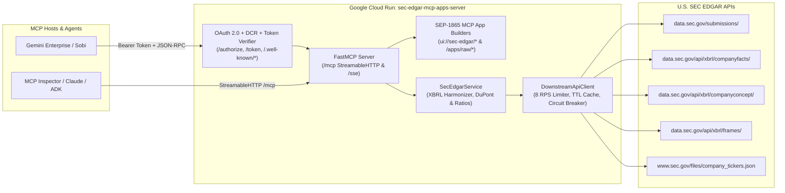
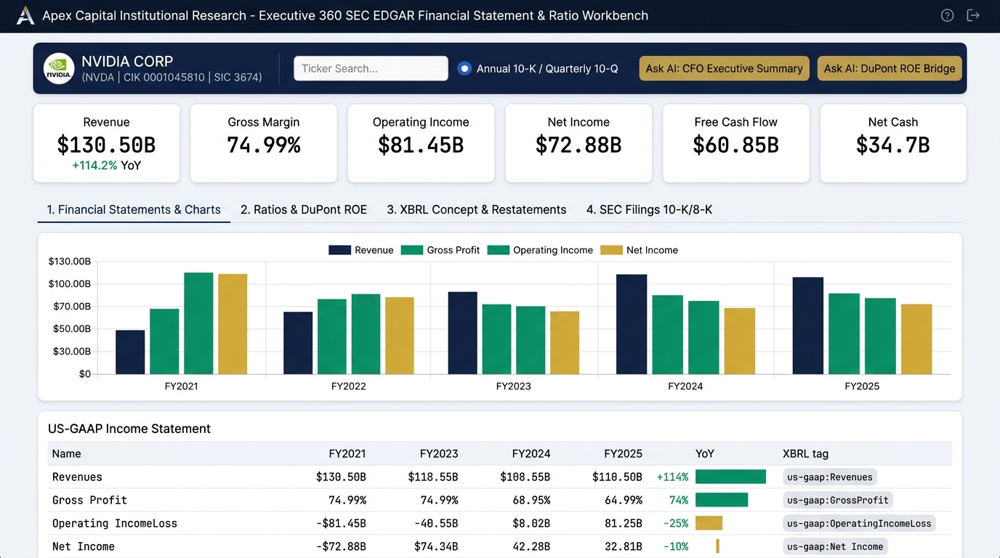
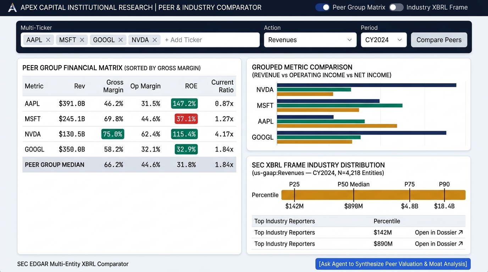

# SEC EDGAR Financial & 10-K Dossier MCP Apps Server

An enterprise-grade **Model Context Protocol (MCP) Server** and **Interactive Visual MCP Apps Suite (`SEP-1865`)** for U.S. Securities and Exchange Commission (**SEC EDGAR**) financial statement analysis, US-GAAP XBRL harmonization, 3-step DuPont ROE decomposition, restatement auditing, 10-K / 10-Q / 8-K / DEF 14A filing inspection, and market-wide peer benchmarking on **Google Cloud Run**.

---

## Table of Contents

1. [Overview & Key Capabilities](#1-overview--key-capabilities)
2. [Architecture & Repository Structure](#2-architecture--repository-structure)
3. [Interactive `ui://` MCP Apps (SEP-1865)](#3-interactive-ui-mcp-apps-sep-1865)
4. [Complete Reference of All 9 MCP Tools](#4-complete-reference-of-all-9-mcp-tools)
5. [How to Deploy to Google Cloud Run (Including OAuth 2.0 Setup)](#5-how-to-deploy-to-google-cloud-run-including-oauth-20-setup)
6. [Registering with Gemini Enterprise & Gemini Sobi (`skill/`)](#6-registering-with-gemini-enterprise--gemini-sobi-skill)
7. [How to Use & Test the Tools](#7-how-to-use--test-the-tools)

---

## 1. Overview & Key Capabilities

Raw SEC EDGAR endpoints (`submissions`, `companyfacts`, `companyconcept`, `frames`) expose multi-megabyte JSON payloads with thousands of changing US-GAAP/IFRS taxonomy tags, duplicate comparative periods across 10-K/10-Q filings, and strict fair-access rate limits.

This server consolidates the entire SEC EDGAR API surface into **9 high-signal MCP tools** (**2 dedicated interactive `ui://` MCP App launchers** + **7 coarse-grained financial & filing workflow tools**):

* **Dual-Delivery Interactive MCP Apps (`text/html;profile=mcp-app`)**:
  - **`ui://sec-edgar/financial-dossier-workbench`**: A 4-tab institutional workbench for single-company 360° financial statements, 3-step DuPont ROE decomposition, interactive XBRL tag tracing with restatement detection, and searchable 10-K / 10-Q / 8-K / DEF 14A filings.
  - **`ui://sec-edgar/peer-industry-comparator`**: A 2-tab peer group benchmarking matrix and market-wide SEC Cross-Company XBRL Frame percentile distribution (`p10`–`p99`) across ~4,800+ reporting public companies.
* **US-GAAP / IFRS Concept Harmonization & Derivation**:
  - Automatically maps 22 canonical financial concepts across changing US-GAAP tags (e.g., `RevenueFromContractWithCustomerExcludingAssessedTax` vs. `Revenues` vs. `SalesRevenueNet`) and derives missing subtotals (such as EBIT `operating_income = pretax_income + interest_expense` or `free_cash_flow = operating_cash_flow - capex`) with full XBRL tag provenance.
* **Restatement Audit Trail & Comparative Period Deduplication**:
  - Prioritizes the most recent filing date (`filed`) for comparative periods so restated figures supersede initial reports, while optionally surfacing the full restatement audit trail (`prior_val`, `delta`, `prior_filed`).
* **SEC Fair-Access Rate Limiting & Circuit Breaker**:
  - Enforces SEC's mandatory `User-Agent` identification header (`SEC_USER_AGENT`) and a token-bucket rate limiter (`<= 8 req/sec`, well below SEC's 10 req/sec ceiling) with exponential backoff and a fail-fast circuit breaker.
* **Multi-Tenant OAuth 2.0 + PKCE + Dynamic Client Registration (DCR)**:
  - Built-in RFC 8414 (`/.well-known/oauth-authorization-server`), RFC 9728 (`/.well-known/oauth-protected-resource`), RFC 7591 (`/register`), `/authorize`, and `/token` endpoints for seamless integration with **Gemini Enterprise**, **Gemini Sobi**, and standard MCP clients.

---

## 2. Architecture & Repository Structure



### Directory Layout

```text
sec_edgar_mcp_apps_server/
├── Dockerfile                        # Production Python 3.12 Slim container image for Cloud Run
├── requirements.txt                  # Pinned Python dependencies (mcp, httpx, starlette, uvicorn, pydantic)
├── main.py                           # CLI & container entrypoint (--transport streamable-http | sse | stdio)
├── server.py                         # FastMCP server, 9 MCP tools, 2 ui:// resources, OAuth 2.0 & preview routes
├── mcp_apps/
│   ├── __init__.py
│   ├── brand_theme.py                # Institutional light-mode design tokens & shared CSS
│   ├── financial_dossier_app.py      # App 1: 360° Financial Statement, DuPont Ratio & 10-K Workbench
│   └── peer_comparator_app.py        # App 2: Peer Group & SEC Cross-Market XBRL Frame Comparator
├── services/
│   ├── __init__.py
│   └── sec_client.py                 # Async SEC EDGAR client, rate limiter, circuit breaker & XBRL harmonizer
├── design/
│   ├── mcp_apps_ux_design.md         # UX design specification for the two interactive MCP Apps
│   ├── dossier_workbench_wireframe.jpg
│   └── peer_comparator_wireframe.jpg
└── skill/
    ├── SKILL.md                      # Sanitized companion skill for Gemini Enterprise / Sobi agents
    └── sec_edgar_mcp_apps_skill.zip  # Ready-to-upload skill archive (after filling in project placeholders)
```

---

## 3. Interactive `ui://` MCP Apps (SEP-1865)

Both MCP Apps are self-contained HTML5/CSS/SVG/JS bundles (`mimeType: "text/html;profile=mcp-app"`) that communicate with the host via the **SEP-1865 JSON-RPC 2.0 `postMessage` bridge** (`ui/initialize`, `ui/notifications/tool-result`, `tools/call`, `ui/open-link`, `ui/message`) and fall back to `/apps/api/tool-call` when opened in a standalone browser tab.

### App 1: Executive 360° Financial Dossier Workbench (`ui://sec-edgar/financial-dossier-workbench`)


* **Tab 1 — Executive Overview & DuPont ROE**:
  - 6-card KPI summary strip (Revenue, Operating Income & Margin, Net Income & Diluted EPS, Free Cash Flow & FCF Margin, Cash vs. Total Debt, Return on Equity & Current Ratio).
  - Multi-period Revenue vs. Operating Income vs. Net Income grouped SVG column chart with YoY growth badges.
  - **3-Step DuPont ROE Decomposition** (`Net Profit Margin %` $\times$ `Asset Turnover` $\times$ `Equity Multiplier` $=$ `Return on Equity`).
* **Tab 2 — Harmonized Financial Statements & Ratios**:
  - Sub-tabs for **Income Statement**, **Balance Sheet**, **Cash Flow Statement**, and **Financial Ratios** across 2–10 fiscal periods with inline sparklines, multi-year CAGR, and exact US-GAAP XBRL tag provenance.
* **Tab 3 — XBRL Tag Explorer & Restatement Audit**:
  - Interactive concept selector (`revenue`, `operating_income`, `net_income`, `r_and_d`, `sbc`, `capex`, `free_cash_flow`, `total_assets`, `total_cash`, `long_term_debt`, `stockholders_equity`, `eps_diluted`, `shares_outstanding`) that dynamically traces historical XBRL filings and flags restated periods.
* **Tab 4 — SEC Filings & 8-K Event Inspector**:
  - Filterable table of `10-K`, `10-Q`, `8-K`, and `DEF 14A` filings with human-readable Form 8-K material event badges (e.g., `Item 2.02: Results of Operations`, `Item 5.02: Officer/Director Changes`) and direct links to official SEC EDGAR Archive documents.

### App 2: Peer Group & SEC Industry XBRL Frame Comparator (`ui://sec-edgar/peer-industry-comparator`)


* **Tab 1 — Peer Group Benchmarking Matrix**:
  - Interactive chip editor for 2–10 peer tickers (e.g., `AAPL, MSFT, GOOGL, NVDA`), horizontal grouped comparison bars, and a sortable matrix comparing Revenue, YoY Revenue Growth, Gross Margin, Operating Margin, Net Margin, ROE, Free Cash Flow, Current Ratio, and Debt-to-Equity against the **Peer Group Median & Mean**.
* **Tab 2 — SEC Industry XBRL Frame Distribution (`p10`–`p99`)**:
  - Queries the SEC Cross-Company XBRL Frames API across all ~4,800+ reporting public companies for a selected concept and calendar year, rendering the `p10` / `p25` / `p50 Median` / `p75` / `p90` / `p99` distribution curve, target company percentile callout, and Top Market Reporters leaderboard.

---

## 4. Complete Reference of All 9 MCP Tools

| # | Tool Name | Category | Linked `ui://` Resource | Description |
|---|---|---|---|---|
| 1 | `open_financial_dossier_workbench_app` | Interactive MCP App | `ui://sec-edgar/financial-dossier-workbench` | Fans out across 4 SEC endpoints and returns the pre-hydrated 360° Financial Dossier Workbench (`EmbeddedResource` + JSON). |
| 2 | `open_peer_industry_comparator_app` | Interactive MCP App | `ui://sec-edgar/peer-industry-comparator` | Benchmarks 2–10 peers + SEC XBRL Calendar Frame and returns the Peer & Industry Comparator (`EmbeddedResource` + JSON). |
| 3 | `get_company_360_financial_dossier` | Workflow Data Tool | `ui://sec-edgar/financial-dossier-workbench` | Resolves ticker/name/CIK and returns corporate governance metadata, key filing URLs, and multi-period headline financials. |
| 4 | `analyze_financial_statements_and_ratios` | Workflow Data Tool | `ui://sec-edgar/financial-dossier-workbench` | Returns multi-period harmonized Income Statement, Balance Sheet, Cash Flow Statement, 13 financial ratios, and CAGR. |
| 5 | `search_and_inspect_sec_filings` | Workflow Data Tool | `ui://sec-edgar/financial-dossier-workbench` | Searches and filters `10-K`, `10-Q`, `8-K`, `DEF 14A` filings by form type, date range, and Form 8-K item code. |
| 6 | `trace_xbrl_metric_history` | Workflow Data Tool | `ui://sec-edgar/financial-dossier-workbench` | Traces up to 25 periods of a specific XBRL tag or canonical concept via `companyconcept`, including restatement audit history. |
| 7 | `compare_peer_group_financials` | Workflow Data Tool | `ui://sec-edgar/peer-industry-comparator` | Benchmarks 2–10 public companies side-by-side across standardized metrics, margins, and peer-group medians/means. |
| 8 | `benchmark_industry_xbrl_frame` | Workflow Data Tool | `ui://sec-edgar/peer-industry-comparator` | Ranks all reporting public companies for a US-GAAP concept in a calendar year/quarter (`CY2024`, `CY2024Q4I`) with `p10`–`p99` percentiles. |
| 9 | `resolve_and_discover_sec_entities` | Discovery Tool | *(Data only)* | Fuzzy-searches SEC-registered companies by name/ticker/CIK and discovers company-specific reported XBRL tags by keyword. |

### Tool Parameter Details

#### 1. `open_financial_dossier_workbench_app`
* `identifier` *(str, default `"NVDA"`)*: Stock ticker symbol (`"NVDA"`, `"AAPL"`, `"IBM"`), company name, or 10-digit CIK.
* `period_type` *(`"annual"` | `"quarterly"`, default `"annual"`)*: Annual (`10-K`) or quarterly (`10-Q`) periods.
* `periods` *(int, default `5`)*: Number of historical periods to align (`2` to `10`).

#### 2. `open_peer_industry_comparator_app`
* `identifiers` *(List[str], default `["AAPL", "MSFT", "GOOGL", "NVDA"]`)*: 2 to 10 peer tickers, names, or CIKs.
* `period_type` *(`"annual"` | `"quarterly"`, default `"annual"`)*: Annual or quarterly alignment.
* `fiscal_year` *(Optional[int], default `None`)*: Optional target fiscal year (e.g., `2024` or `2025`).
* `benchmark_concept` *(str, default `"revenue"`)*: Concept for SEC frame ranking (`"revenue"`, `"operating_income"`, `"net_income"`, `"total_assets"`, `"total_cash"`, `"r_and_d"`).
* `calendar_year` *(int, default `2024`)*: Calendar year for the SEC XBRL Frame distribution.

#### 3. `get_company_360_financial_dossier`
* `identifier` *(str, required)*: Stock ticker, company name, or CIK.
* `period_type` *(`"annual"` | `"quarterly"`, default `"annual"`)*: `"annual"` or `"quarterly"`.
* `periods` *(int, default `4`)*: Number of most recent fiscal periods (`1` to `10`).
* `include_recent_filings` *(bool, default `True`)*: Include direct SEC Archive links to latest `10-K`, `10-Q`, `DEF 14A`, and `8-K`s.

#### 4. `analyze_financial_statements_and_ratios`
* `identifier` *(str, required)*: Stock ticker, company name, or CIK.
* `statement_types` *(Optional[List[str]], default all 4)*: Subset of `["income_statement", "balance_sheet", "cash_flow", "ratios"]`.
* `period_type` *(`"annual"` | `"quarterly"`, default `"annual"`)*: `"annual"` or `"quarterly"`.
* `periods` *(int, default `5`)*: Number of historical periods (`2` to `10`).

#### 5. `search_and_inspect_sec_filings`
* `identifier` *(str, required)*: Stock ticker, company name, or CIK.
* `form_types` *(Optional[List[str]], default `["10-K", "10-Q", "8-K", "DEF 14A"]`)*: SEC form types to filter.
* `start_date` / `end_date` *(Optional[str])*: ISO date range (`"YYYY-MM-DD"`).
* `item_8k_filter` *(Optional[str])*: Form 8-K item code or keyword (e.g., `"2.02"` for Earnings, `"1.05"` for Cybersecurity, `"5.02"` for Leadership Changes).
* `include_amendments` *(bool, default `True`)*: Include `10-K/A`, `10-Q/A`, etc.
* `limit` *(int, default `15`)*: Max filings to return (`1` to `50`).

#### 6. `trace_xbrl_metric_history`
* `identifier` *(str, required)*: Stock ticker, company name, or CIK.
* `concept_or_tag` *(str, required)*: Canonical alias (`"revenue"`, `"r_and_d"`, `"sbc"`, `"capex"`, `"operating_income"`, `"shares_outstanding"`) or exact US-GAAP tag (`"ResearchAndDevelopmentExpense"`, `"Goodwill"`).
* `taxonomy` *(`"us-gaap"` | `"dei"` | `"ifrs-full"`, default `"us-gaap"`)*: XBRL taxonomy namespace.
* `period_type` *(`"annual"` | `"quarterly"` | `"all"`, default `"annual"`)*: Period filter.
* `periods` *(int, default `10`)*: Number of historical periods (`1` to `25`).
* `include_restatement_audit` *(bool, default `False`)*: Include prior restated values reported across subsequent filings.

#### 7. `compare_peer_group_financials`
* `identifiers` *(List[str], required)*: 2 to 10 peer tickers, names, or CIKs.
* `metrics` *(Optional[List[str]])*: Optional subset of metric keys.
* `period_type` *(`"annual"` | `"quarterly"`, default `"annual"`)*: `"annual"` or `"quarterly"`.
* `fiscal_year` *(Optional[int])*: Optional target fiscal year to align all peers.

#### 8. `benchmark_industry_xbrl_frame`
* `concept_or_tag` *(str, required)*: Canonical concept (`"revenue"`, `"net_income"`, `"total_assets"`, `"total_cash"`, `"r_and_d"`) or exact XBRL tag.
* `calendar_year` *(int, default `2024`)*: Calendar year (`2019`–`2025`).
* `calendar_quarter` *(Optional[int])*: Optional quarter (`1`–`4`). Omit for full-year durational frame.
* `highlight_identifier` *(Optional[str])*: Ticker/name/CIK to highlight with exact rank and percentile.
* `unit` *(str, default `"USD"`)*: Unit of measure (`"USD"`, `"shares"`, `"USD-per-shares"`).
* `taxonomy` *(`"us-gaap"` | `"dei"` | `"ifrs-full"`, default `"us-gaap"`)*: Taxonomy namespace.
* `top_n` *(int, default `15`)*: Number of top leaders to return (`5` to `40`).

#### 9. `resolve_and_discover_sec_entities`
* `company_query` *(str, required)*: Partial company name, ticker, or CIK (e.g., `"Alphabet"`, `"Berkshire"`).
* `xbrl_tag_keyword` *(Optional[str])*: Optional keyword (e.g., `"inventory"`, `"lease"`, `"deferred"`) to search the company's reported XBRL tags.
* `limit` *(int, default `5`)*: Maximum matching companies to return (`1` to `15`).

---

## 5. How to Deploy to Google Cloud Run (Including OAuth 2.0 Setup)

### Prerequisites
1. Google Cloud SDK (`gcloud`) installed and authenticated.
2. A Google Cloud Project with **Cloud Run**, **Cloud Build**, and **Secret Manager** APIs enabled:
   ```bash
   export PROJECT_ID="your-gcp-project-id"
   export REGION="us-central1"
   export SERVICE_NAME="sec-edgar-mcp-apps-server"

   gcloud config set project "${PROJECT_ID}"
   gcloud services enable run.googleapis.com cloudbuild.googleapis.com secretmanager.googleapis.com
   ```
3. **SEC Fair-Access User-Agent (`SEC_USER_AGENT`)**:
   - The U.S. SEC requires all automated requests to `data.sec.gov` to declare a descriptive `User-Agent` header in the format `OrganizationName ApplicationName/Version (contact@domain.com)`.

---

### Step 1: Create OAuth 2.0 Client Credentials & Store in Secret Manager

When registering an OAuth-protected MCP Server with **Gemini Enterprise** (Discovery Engine) or other OAuth 2.0 MCP hosts, the server validates the OAuth Client ID & Secret and signs authorization codes/tokens using an HMAC signing secret.

1. **Create an OAuth 2.0 Web Application Client ID in Google Cloud Console**:
   - Navigate to **APIs & Services > Credentials > Create Credentials > OAuth client ID**.
   - Select **Web application**.
   - Under **Authorized redirect URIs**, add the Gemini Enterprise OAuth redirect URI:
     ```text
     https://vertexaisearch.cloud.google.com/oauth-redirect
     ```
   - Copy the generated **Client ID** and **Client Secret**.

2. **Store the OAuth Credentials in Google Cloud Secret Manager**:
   ```bash
   # 1. Store OAuth Client ID
   printf "%s" "YOUR_GOOGLE_OAUTH_CLIENT_ID" | \
     gcloud secrets create mcp-oauth-client-id --data-file=- --replication-policy="automatic"

   # 2. Store OAuth Client Secret
   printf "%s" "YOUR_GOOGLE_OAUTH_CLIENT_SECRET" | \
     gcloud secrets create mcp-oauth-client-secret --data-file=- --replication-policy="automatic"

   # 3. Generate and store a 256-bit HMAC signing secret for stateless OAuth codes/tokens
   openssl rand -hex 32 | tr -d '\n' | \
     gcloud secrets create mcp-auth-signing-secret --data-file=- --replication-policy="automatic"
   ```

3. **Grant the Cloud Run Service Account Access to the Secrets**:
   ```bash
   PROJECT_NUMBER=$(gcloud projects describe "${PROJECT_ID}" --format="value(projectNumber)")
   COMPUTE_SA="${PROJECT_NUMBER}-compute@developer.gserviceaccount.com"

   for SECRET in mcp-oauth-client-id mcp-oauth-client-secret mcp-auth-signing-secret; do
     gcloud secrets add-iam-policy-binding "${SECRET}" \
       --member="serviceAccount:${COMPUTE_SA}" \
       --role="roles/secretmanager.secretAccessor"
   done
   ```

---

### Step 2: Deploy the MCP Server to Google Cloud Run

Run `gcloud run deploy` from the `sec_edgar_mcp_apps_server/` directory:

```bash
gcloud run deploy "${SERVICE_NAME}" \
  --source . \
  --region "${REGION}" \
  --allow-unauthenticated \
  --min-instances=1 \
  --max-instances=5 \
  --concurrency=80 \
  --cpu=2 \
  --memory=1Gi \
  --timeout=120 \
  --set-env-vars="MCP_TRANSPORT=streamable-http,MCP_STATELESS_HTTP=true,REQUIRE_OAUTH=true,OAUTH_REQUIRED_SCOPES=openid email,SEC_USER_AGENT=YourCompanyName SecEdgarMCP/2.0 (contact@yourcompany.com)" \
  --set-secrets="GOOGLE_OAUTH_CLIENT_ID=mcp-oauth-client-id:latest,GOOGLE_OAUTH_CLIENT_SECRET=mcp-oauth-client-secret:latest,MCP_AUTH_SIGNING_SECRET=mcp-auth-signing-secret:latest"
```

> **Note on `--allow-unauthenticated`:** Cloud Run's IAM layer is set to allow public HTTPS ingress so that browser clients, Gemini Enterprise OAuth redirects (`/authorize`, `/token`), and RFC 8414/9728 metadata discovery (`/.well-known/*`) can reach the container. Application-level authentication is enforced inside the server via `REQUIRE_OAUTH=true` and `GoogleOAuthTokenVerifier`.

Once deployed, retrieve your Cloud Run URL and (optionally) set `MCP_PUBLIC_BASE_URL`:

```bash
SERVICE_URL=$(gcloud run services describe "${SERVICE_NAME}" --region "${REGION}" --format="value(status.url)")
echo "Deployed URL: ${SERVICE_URL}"

gcloud run services update "${SERVICE_NAME}" \
  --region "${REGION}" \
  --update-env-vars="MCP_PUBLIC_BASE_URL=${SERVICE_URL},MCP_RESOURCE_SERVER_URL=${SERVICE_URL}/mcp"
```

---

### Step 3: Verify Health & OAuth Discovery Endpoints

```bash
# 1. Health & Circuit Breaker Status
curl -s "${SERVICE_URL}/health" | jq .

# 2. OAuth 2.0 Authorization Server Metadata (RFC 8414)
curl -s "${SERVICE_URL}/.well-known/oauth-authorization-server" | jq .

# 3. OAuth 2.0 Protected Resource Metadata (RFC 9728)
curl -s "${SERVICE_URL}/.well-known/oauth-protected-resource" | jq .
```

---

## 6. Registering with Gemini Enterprise & Gemini Sobi (`skill/`)

### 6.1 Registering the MCP Server in Gemini Enterprise
You can register the deployed Cloud Run service in Gemini Enterprise (**Discovery Engine**) as a Custom MCP (`custom_mcp`) connector using the Discovery Engine REST API:

```bash
export GE_PROJECT_ID="your-gemini-enterprise-project-id"
export COLLECTION_ID="sec-edgar-mcp-apps"
export OAUTH_CLIENT_ID="YOUR_GOOGLE_OAUTH_CLIENT_ID"
export OAUTH_CLIENT_SECRET="YOUR_GOOGLE_OAUTH_CLIENT_SECRET"

TOKEN=$(gcloud auth print-access-token)

# 1. Create the Collection & DataConnector
curl -s -X POST \
  -H "Authorization: Bearer ${TOKEN}" \
  -H "Content-Type: application/json" \
  -H "X-Goog-User-Project: ${GE_PROJECT_ID}" \
  "https://discoveryengine.googleapis.com/v1alpha/projects/${GE_PROJECT_ID}/locations/global/collections?collectionId=${COLLECTION_ID}" \
  -d '{"displayName": "SEC EDGAR Financial & 10-K Dossier MCP Apps"}'

curl -s -X PATCH \
  -H "Authorization: Bearer ${TOKEN}" \
  -H "Content-Type: application/json" \
  -H "X-Goog-User-Project: ${GE_PROJECT_ID}" \
  "https://discoveryengine.googleapis.com/v1alpha/projects/${GE_PROJECT_ID}/locations/global/collections/${COLLECTION_ID}/dataConnector?updateMask=*" \
  -d "{
    \"name\": \"projects/${GE_PROJECT_ID}/locations/global/collections/${COLLECTION_ID}/dataConnector\",
    \"dataSource\": \"custom_mcp\",
    \"connectorType\": \"THIRD_PARTY\",
    \"actionConfig\": {
      \"actionParams\": {
        \"mcp_server_uri\": \"${SERVICE_URL}/mcp\",
        \"authorization_Endpoint\": \"${SERVICE_URL}/authorize\",
        \"token_endpoint\": \"${SERVICE_URL}/token\",
        \"client_id\": \"${OAUTH_CLIENT_ID}\",
        \"client_secret\": \"${OAUTH_CLIENT_SECRET}\",
        \"scopes\": \"openid email profile\"
      },
      \"isActionConfigured\": true
    },
    \"bapConfig\": {
      \"supportedConnectorModes\": [\"ACTIONS\"]
    }
  }"
```

### 6.2 Onboarding the Companion Skill (`skill/SKILL.md`) in Gemini Sobi
The [`skill/`](./skill/) directory contains the companion skill ([`skill/SKILL.md`](./skill/SKILL.md)) designed for Gemini Sobi agents:
1. Open [`skill/SKILL.md`](./skill/SKILL.md) and replace:
   - `<YOUR_PROJECT_NUMBER>` with your numeric Google Cloud project number.
   - `<YOUR_CLOUD_RUN_SERVICE_URL>` with your deployed Cloud Run hostname (e.g., `sec-edgar-mcp-apps-server-xxxxxx-uc.a.run.app`).
2. Re-package `SKILL.md` into `sec_edgar_mcp_apps_skill.zip`:
   ```bash
   cd skill && zip -q -r sec_edgar_mcp_apps_skill.zip SKILL.md && cd ..
   ```
3. Upload `sec_edgar_mcp_apps_skill.zip` as a Skill in Gemini Enterprise / Sobi and attach both the Skill and the `sec-edgar-mcp-apps` MCP server to your agent.

---

## 7. How to Use & Test the Tools

### 7.1 Running Locally for Development

```bash
# Create virtual environment and install dependencies
python3 -m venv .venv
source .venv/bin/activate
pip install -r requirements.txt

# Run locally on http://localhost:8080 (with OAuth disabled for local testing)
export SEC_USER_AGENT="YourOrg LocalDev/2.0 (dev@yourorg.com)"
export REQUIRE_OAUTH="false"
python3 main.py --transport streamable-http --port 8080
```

### 7.2 Interactive Browser Previews (`/apps/raw/*`)
While running locally (or on Cloud Run), you can test both interactive SEP-1865 MCP Apps directly in your browser:
* **App 1 — 360° Financial Dossier Workbench**:
  - `http://localhost:8080/apps/raw/financial-dossier-workbench?identifier=NVDA&period_type=annual&periods=5`
* **App 2 — Peer Group & Industry XBRL Frame Comparator**:
  - `http://localhost:8080/apps/raw/peer-industry-comparator?identifiers=AAPL,MSFT,GOOGL,NVDA&concept=revenue&year=2024`

### 7.3 Testing via JSON-RPC (`/mcp`)

```bash
# List all 9 tools
curl -s -X POST "http://localhost:8080/mcp" \
  -H "Content-Type: application/json" \
  -H "Accept: application/json, text/event-stream" \
  -d '{
    "jsonrpc": "2.0",
    "id": 1,
    "method": "tools/list",
    "params": {}
  }' | jq .

# Invoke get_company_360_financial_dossier for NVIDIA
curl -s -X POST "http://localhost:8080/mcp" \
  -H "Content-Type: application/json" \
  -H "Accept: application/json, text/event-stream" \
  -d '{
    "jsonrpc": "2.0",
    "id": 2,
    "method": "tools/call",
    "params": {
      "name": "get_company_360_financial_dossier",
      "arguments": {
        "identifier": "NVDA",
        "period_type": "annual",
        "periods": 4
      }
    }
  }' | jq .
```

### 7.4 Sample Natural Language Prompts for Gemini Enterprise

* **360° Financial Dossier & DuPont Analysis (`open_financial_dossier_workbench_app`)**:
  > *"Open the 360-degree SEC EDGAR financial dossier workbench for NVIDIA (NVDA) over the last 5 fiscal years and decompose its Return on Equity using the 3-step DuPont formula."*
* **Multi-Period Financial Statement & Ratio Analysis (`analyze_financial_statements_and_ratios`)**:
  > *"Analyze Apple's (AAPL) last 5 annual Income Statements, Balance Sheets, Cash Flow Statements, and financial ratios from SEC 10-K filings, including revenue and free cash flow CAGR."*
* **Peer Group & Industry XBRL Frame Benchmarking (`open_peer_industry_comparator_app`)**:
  > *"Compare NVDA, AMD, AVGO, and INTC side-by-side on revenue growth, gross margin, operating margin, and ROE, and rank them against the entire U.S. public market using the 2024 SEC XBRL Revenue Frame."*
* **XBRL Metric History & Restatement Audit (`trace_xbrl_metric_history`)**:
  > *"Trace Eli Lilly's (LLY) R&D expense (`r_and_d`) over the past 10 fiscal years from SEC XBRL filings and check whether any prior periods were restated."*
* **SEC Filing & 8-K Event Inspection (`search_and_inspect_sec_filings`)**:
  > *"Find Microsoft's (MSFT) recent 10-K, 10-Q, DEF 14A proxy statements, and Form 8-K Item 2.02 earnings releases with direct SEC Archive links."*
