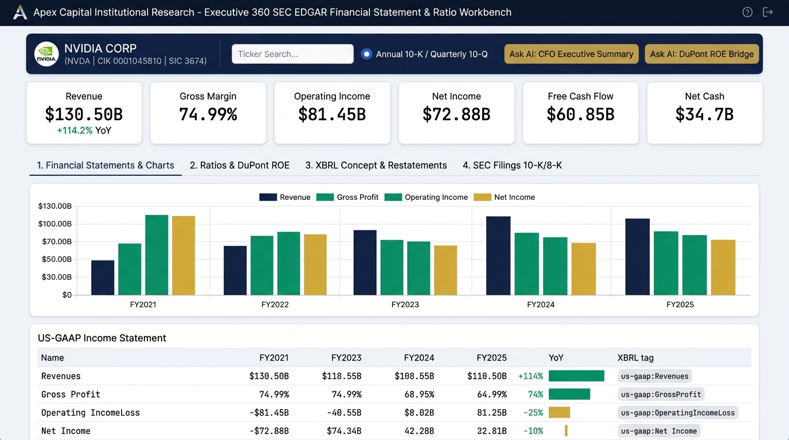
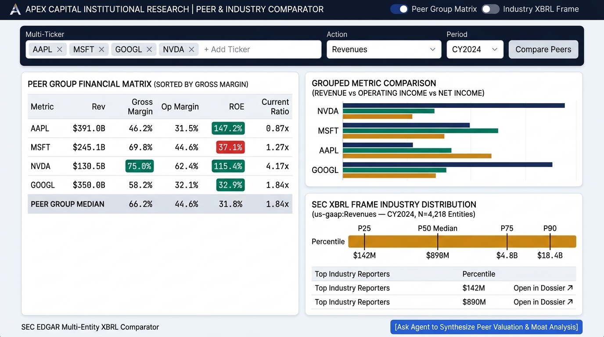

# SEC EDGAR Interactive MCP Apps (`ui://`) — UX & Brand Theme Design Specification

**Organization / Brand:** `Apex Capital Institutional Research`  
**Target Standalone MCP Apps Server:** `sec_edgar_mcp_apps_server/`  
**Protocol Specification:** Model Context Protocol — MCP Apps Extension (**SEP-1865**, `ui://` URI scheme, MIME type `text/html;profile=mcp-app`, bidirectional JSON-RPC 2.0 over `window.parent.postMessage`)

---

## 1. Audit of Existing SEC EDGAR Tools & Consolidation into Interactive MCP Apps

We audited all **7 coarse-grained SEC EDGAR workflow tools** in [`server.py`](../server.py) to determine where static markdown tables fall short and how interactive visual workbenches elevate analyst productivity:

| # | Existing Tool in `sec_edgar_mcp_server` | Current Markdown / Text Limitation | Target MCP App Workbench (`ui://sec-edgar/...`) |
| :--- | :--- | :--- | :--- |
| **1** | `get_company_360_financial_dossier` | Multi-period headline metrics, ratios, corporate profile, and 10-K/10-Q/8-K links require scrolling through 150+ lines of text; switching between Annual (10-K) and Quarterly (10-Q) requires a new chat turn. | **Workbench 1:** `ui://sec-edgar/financial-dossier-workbench` *(Overview + KPI Strip + Filings)* |
| **2** | `analyze_financial_statements_and_ratios` | 3 full financial statements (Income Statement, Balance Sheet, Cash Flow) + 13 ratios across 5 periods create wide, wrapped markdown tables; hard to visually spot margin inflection points or DuPont ROE drivers. | **Workbench 1:** `ui://sec-edgar/financial-dossier-workbench` *(Statements & DuPont Ratios Tabs)* |
| **3** | `trace_xbrl_metric_history` | 10-to-25 period time-series and restatement audit trails are much clearer as an interactive bar/trend chart with restatement delta callouts and a live concept selector. | **Workbench 1:** `ui://sec-edgar/financial-dossier-workbench` *(XBRL Concept & Restatement Tab)* |
| **4** | `search_and_inspect_sec_filings` | Filtering filings by form (`10-K`, `10-Q`, `8-K`, `DEF 14A`) or 8-K Item code (`2.02` Earnings, `5.02` Officers) benefits from instant click-to-filter pills and clickable SEC EDGAR Archive badges. | **Workbench 1:** `ui://sec-edgar/financial-dossier-workbench` *(SEC Filings & 8-K Events Tab)* |
| **5** | `compare_peer_group_financials` | Comparing 2–10 peer companies across 15+ metrics & medians in markdown wraps badly; analysts need a synchronized side-by-side matrix with color-coded outperformance/underperformance badges vs. the peer median and live peer ticker chips. | **Workbench 2:** `ui://sec-edgar/peer-industry-comparator` *(Peer Group Matrix Tab)* |
| **6** | `benchmark_industry_xbrl_frame` | Market-wide percentile distributions (`p10`–`p99`) across ~4,800+ public companies and Top-N leaderboards are ideal for a visual percentile thermometer bar and interactive concept/year selector. | **Workbench 2:** `ui://sec-edgar/peer-industry-comparator` *(Industry XBRL Frame Distribution Tab)* |
| **7** | `resolve_and_discover_sec_entities` | Fuzzy entity lookup and XBRL tag discovery helper used by both workbenches' live ticker search bars and XBRL tag autocomplete. | **Shared Helper Tool** invoked via `tools/call` from both workbenches |

---

## 2. System Architecture & Dual-Delivery Lifecycle

```mermaid
sequenceDiagram
    participant Analyst as Institutional Analyst
    participant Host as MCP Host UI (Chat + Sandboxed Iframe)
    participant Server as sec_edgar_mcp_apps_server (Cloud Run)
    participant SEC as SEC EDGAR REST APIs (data.sec.gov)

    Analyst->>Host: "Open the 360° financial workbench for NVIDIA"
    Host->>Server: tools/call open_financial_dossier_workbench_app(identifier="NVDA")
    Server->>SEC: Parallel fan-out (submissions + companyfacts)
    SEC-->>Server: Raw SEC JSON payloads
    Server->>Server: Harmonize GAAP tags + enrich_dossier_workbench_payload()
    Server-->>Host: CallToolResult (TextContent + EmbeddedResource ui://sec-edgar/financial-dossier-workbench + structuredContent)
    Host->>Host: Mounts sandboxed iframe (text/html;profile=mcp-app)
    Host->>Host: SEP-1865 Handshake (ui/initialize -> hostContext.theme -> ui/notifications/tool-result)
    Analyst->>Host: Toggles "Quarterly (10-Q)" or switches ticker to "IBM" inside iframe
    Host->>Server: postMessage(tools/call -> open_financial_dossier_workbench_app)
    Server-->>Host: Updated structuredContent -> Iframe re-renders charts & statements in-place
    Analyst->>Host: Clicks "✨ Ask AI: DuPont ROE & Margin Bridge" inside iframe
    Host->>Host: postMessage(ui/message) -> Injects structured financial prompt into AI Chat
```

### Dual-Delivery Support Across All MCP Hosts
Each of the two workbenches in `sec_edgar_mcp_apps_server` implements **both** SEP-1865 delivery mechanisms:
1. **Registered `@mcp.resource("ui://sec-edgar/<view-slug>", mime_type="text/html;profile=mcp-app")` + Linked Data Tools (`meta=APP_TOOL_META`):**
   - Calling `get_company_360_financial_dossier` or `analyze_financial_statements_and_ratios` automatically enriches and caches the workbench payload (`set_cached_dossier_payload`) so hosts that issue `resources/read` on `ui://sec-edgar/financial-dossier-workbench` receive pre-hydrated HTML immediately.
   - Calling `compare_peer_group_financials` or `benchmark_industry_xbrl_frame` caches the comparator payload (`set_cached_peer_payload`) for `ui://sec-edgar/peer-industry-comparator`.
2. **Dedicated Launcher Tools (`open_financial_dossier_workbench_app` & `open_peer_industry_comparator_app`):**
   - Return a `CallToolResult` containing `TextContent` (compact JSON for LLM reasoning), `EmbeddedResource` (`TextResourceContents` with `mimeType="text/html;profile=mcp-app"` and `_meta=APP_RESOURCE_META`), and `structuredContent`.
3. **Standalone Browser Preview & JSON API Routes (`Cross-Origin-Opener-Policy: unsafe-none`):**
   - `GET /apps/raw/financial-dossier-workbench?identifier=NVDA&period_type=annual&periods=5`
   - `GET /apps/raw/peer-industry-comparator?identifiers=NVDA,AMD,INTC,AVGO&concept=revenue&year=2024`
   - `POST /apps/api/tool-call` (HTTP fallback for standalone browser tab testing when `window.parent === window`).

---

## 3. Corporate Brand & Theme Specification (`Apex Capital Institutional Research`)

Both MCP Apps share a unified **`BRAND_THEME`** token system designed for high-density institutional equity research terminals. **Light Mode (`:root`, `data-theme="light"`) is the mandatory default institutional theme across both workbenches** (matching both approved wireframes) and is locked against automatic host-context dark-mode overrides (`LOCK_DESIGN_THEME = True`), while retaining an optional manual in-app toggle button.

### Complete CSS Custom Properties Token Table

| CSS Variable | `BRAND_THEME` Key | Light Mode (`:root`) | Dark Mode (`[data-theme="dark"]`) | Semantic Role in UI |
| :--- | :--- | :--- | :--- | :--- |
| `--bg` | `bg_canvas` / `dark_bg_canvas` | `#f1f5f9` *(Slate 100)* | `#090d16` *(Obsidian Terminal)* | Outer workbench canvas background |
| `--surface` | `bg_surface` / `dark_bg_surface` | `#ffffff` *(Pure White)* | `#0f172a` *(Deep Institutional Navy)* | Primary card, table, and chart surface |
| `--surface-alt` | `bg_surface_alt` / `dark_bg_surface_alt` | `#f8fafc` *(Slate 50)* | `#1e293b` *(Slate 800)* | Table header rows, zebra striping, filter bar |
| `--border` | `border_color` / `dark_border_color` | `#cbd5e1` *(Slate 300)* | `#334155` *(Slate 700)* | 1px crisp structural hairlines and table borders |
| `--text` | `text_primary` / `dark_text_primary` | `#0f172a` *(Deep Navy)* | `#f8fafc` *(Crisp Alabaster)* | Primary financial figures, headings, and labels |
| `--text-muted` | `text_muted` / `dark_text_muted` | `#475569` *(Slate 600)* | `#94a3b8` *(Slate 400)* | XBRL tag provenance subtitles, units, axis labels |
| `--primary` | `primary_color` / `dark_primary_color` | `#1e3a8a` *(Institutional Navy)* | `#3b82f6` *(Institutional Royal Blue)* | Primary action buttons, active tabs, revenue bars |
| `--primary-light` | `primary_light` / `dark_primary_light` | `#dbeafe` *(Navy Tint)* | `#172554` *(Deep Navy Badge)* | Active tab/pill background, selected row highlight |
| `--emerald` | `emerald_color` / `dark_emerald_color` | `#059669` *(Financial Emerald)* | `#10b981` *(Luminous Emerald)* | Positive YoY growth, margin expansion, peer outperformance |
| `--emerald-bg` | `emerald_bg` / `dark_emerald_bg` | `#d1fae5` | `rgba(16, 185, 129, 0.16)` | Positive delta badge background |
| `--crimson` | `crimson_color` / `dark_crimson_color` | `#dc2626` *(Drawdown Crimson)* | `#f87171` *(Soft Crimson)* | Negative YoY growth, margin compression, high-debt warning |
| `--crimson-bg` | `crimson_bg` / `dark_crimson_bg` | `#fee2e2` | `rgba(248, 113, 113, 0.16)` | Negative delta / risk badge background |
| `--gold` | `gold_accent` / `dark_gold_accent` | `#d97706` *(Slate Gold)* | `#fbbf24` *(Amber Gold)* | SEC 10-K/8-K filing badges, CAGR badges, target percentile pin |
| `--gold-bg` | `gold_bg` / `dark_gold_bg` | `#fef3c7` | `rgba(251, 191, 36, 0.16)` | Filing badge and derived-XBRL note callout background |
| `--font-sans` | `font_sans` | `'Inter', -apple-system, BlinkMacSystemFont, sans-serif` | `'Inter', -apple-system, BlinkMacSystemFont, sans-serif` | UI chrome, section headers, and analytical notes |
| `--font-mono` | `font_mono` | `'JetBrains Mono', ui-monospace, monospace` | `'JetBrains Mono', ui-monospace, monospace` | All financial statement tables, tickers, CIKs, XBRL tags (`tabular-nums`) |
| `--radius-sm` | `radius_sm` | `6px` | `6px` | Cards, inputs, buttons, and KPI tiles |
| `--radius-md` | `radius_md` | `6px` | `6px` | Outer terminal panels and modal containers |

---

## 4. MCP App 1: Executive 360° Financial Statement, Ratio & Filing Workbench

### 4.1 Resource & Tool Contract
* **Resource URI:** `ui://sec-edgar/financial-dossier-workbench`
* **MIME Type:** `text/html;profile=mcp-app`
* **Linked Data Tools (`meta=DOSSIER_APP_TOOL_META`):**
  * `get_company_360_financial_dossier`
  * `analyze_financial_statements_and_ratios`
  * `search_and_inspect_sec_filings`
  * `trace_xbrl_metric_history`
* **Dedicated Launcher Tool Signature:**
  ```python
  @mcp.tool(annotations=READ_ONLY_ANNOTATIONS, meta=DOSSIER_APP_TOOL_META)
  async def open_financial_dossier_workbench_app(
      identifier: str = "NVDA",
      period_type: Literal["annual", "quarterly"] = "annual",
      periods: int = 5,
  ) -> CallToolResult:
      """Opens the interactive Apex Capital 360° SEC EDGAR Financial Statement, Ratio & 10-K Filing Workbench."""
  ```

### 4.2 Visual Wireframe & Multi-Tab Layout



```
+----------------------------------------------------------------------------------------------------------+
| [APEX CAPITAL INSTITUTIONAL RESEARCH]                                        [Theme: ☀️/🌙] [Live SEC API]|
| NVIDIA CORP (NVDA • CIK 0001045810) | SIC 3674 Semiconductors | FYE Jan 31 | State: DE                   |
| [Ticker/CIK: NVDA   ] [Load] | Period: (• Annual 10-K | ○ Quarterly 10-Q) | [5 Periods v]                |
| [✨ Ask AI: CFO Executive Summary] [✨ Ask AI: DuPont ROE & Margin Bridge] [✨ Ask AI: 10-K Audit Prompt]  |
+----------------------------------------------------------------------------------------------------------+
| KPI 1: REVENUE (FY25) | KPI 2: GROSS MARGIN | KPI 3: OPERATING INC | KPI 4: NET INCOME  | KPI 5: FREE CF | KPI 6: NET CASH/DEBT |
| $130.50B              | 74.99%              | $81.45B (62.42% OPM) | $72.88B ($2.94 EPS)| $60.85B (46.6%)| -$34.8B Net Debt    |
| [+114.2% YoY | +69% C]| [Emerald Badge]     | [CAGR: +168.4%]      | [+144.9% YoY]      | [CapEx: $3.2B] | [Cash $43.2B|CR 4.4]|
+----------------------------------------------------------------------------------------------------------+
| TABS: [ 1. Financial Statements & Charts ] [ 2. Ratios & DuPont ROE ] [ 3. XBRL Concept & Restatements ] [ 4. SEC Filings (10-K/8-K) ]
+----------------------------------------------------------------------------------------------------------+
| [TAB 1 ACTIVE: FINANCIAL STATEMENTS & MULTI-PERIOD TREND CHART]                                          |
| +------------------------------------------------------------------------------------------------------+ |
| | INTERACTIVE SVG GROUPED BAR & MARGIN LINE CHART (FY2021 – FY2025)                                    | |
| | Bars: [■ Revenue (#1e3a8a)] [■ Gross Profit (#059669)] [■ Operating Income (#d97706)] [■ Net Income] | |
| | (Click any fiscal period bar to highlight column in statement table below)                           | |
| +------------------------------------------------------------------------------------------------------+ |
| Statement Sub-Tabs: (• Income Statement | ○ Balance Sheet | ○ Cash Flow Statement)  [Show XBRL Tags: ☑]  |
| [!NOTE Banner if derived subtotals exist (e.g. IBM EBIT = Pretax + Interest): Accounting Structure Note] |
| +-----------------------------------+--------------+--------------+--------------+--------------+------+ |
| | Line Item (US-GAAP Harmonized)    |   2025-01-26 |   2024-01-28 |   2023-01-29 |   2022-01-30 | CAGR | |
| +-----------------------------------+--------------+--------------+--------------+--------------+------+ |
| | Revenue (us-gaap:Revenues)        |    $130,497M |     $60,922M |     $26,974M |     $26,914M | +69% | |
| | Cost of Revenue                   |     $32,639M |     $16,621M |     $11,618M |      $9,439M | +36% | |
| | Gross Profit                      |     $97,858M |     $44,301M |     $15,356M |     $17,475M | +54% | |
| | R&D Expense                       |     $12,914M |      $8,675M |      $7,339M |      $5,268M | +25% | |
| | SG&A Expense                      |      $3,491M |      $2,654M |      $2,440M |      $2,166M | +13% | |
| | Operating Income (EBIT)           |     $81,453M |     $32,972M |      $4,224M |     $10,041M | +69% | |
| | Net Income                        |     $72,880M |     $29,760M |      $4,368M |      $9,752M | +65% | |
| +-----------------------------------+--------------+--------------+--------------+--------------+------+ |
+----------------------------------------------------------------------------------------------------------+
```

### 4.3 Detailed Tab Breakdown (`ui://sec-edgar/financial-dossier-workbench`)
1. **Tab 1 — Multi-Period Financial Statements & Interactive Trend Chart:**
   - **Interactive SVG Chart:** Multi-period grouped bar chart comparing `Revenue`, `Gross Profit`, `Operating Income (EBIT)`, `Net Income`, and `Free Cash Flow` across all aligned periods, with hover tooltips and click-to-highlight period columns.
   - **Statement Switcher:** Instant client-side sub-tabs for **Income Statement** (16 harmonized line items including derived EBIT / `total_expense_and_other_net` when applicable), **Balance Sheet** (16 line items including `ppe_net`, `total_debt`, `stockholders_equity`), and **Cash Flow Statement** (9 line items including `operating_cash_flow`, `investing_cash_flow`, `financing_cash_flow`, `capex`, `free_cash_flow`).
   - **XBRL Provenance & Accounting Notes:** Toggleable column showing the exact `us-gaap:` / `dei:` / `derived:` tag for each row, plus an amber institutional alert banner (`--gold-bg`) whenever `accounting_structure_notes` is present.
2. **Tab 2 — Profitability, Liquidity, Leverage & 3-Factor DuPont ROE Decomposition:**
   - **Visual DuPont ROE Tree:** Interactive 3-box decomposition card showing $\text{ROE} = \text{Net Profit Margin} \left(\frac{\text{Net Income}}{\text{Revenue}}\right) \times \text{Asset Turnover} \left(\frac{\text{Revenue}}{\text{Total Assets}}\right) \times \text{Equity Multiplier} \left(\frac{\text{Total Assets}}{\text{Stockholders' Equity}}\right)$ across periods so analysts can immediately see whether ROE is driven by margin expansion, asset efficiency, or financial leverage.
   - **Multi-Period Ratio Matrix:** Color-coded badges for YoY Revenue Growth %, YoY Net Income Growth %, Gross Margin %, Operating Margin %, Net Margin %, FCF Margin %, R&D % of Revenue, ROE %, ROA %, Current Ratio, Quick Ratio, Debt-to-Equity, and Net Debt.
3. **Tab 3 — XBRL Concept Time-Series & Restatement Audit Inspector:**
   - **Live Concept Picker:** Quick-select pills (`revenue`, `r_and_d`, `sbc`, `capex`, `operating_income`, `goodwill`, `shares_outstanding`) plus a custom XBRL tag input (e.g., `ResearchAndDevelopmentExpense`) and `Annual` / `Quarterly` toggle.
   - **Live `tools/call` Integration:** Clicking any concept invokes `trace_xbrl_metric_history(..., include_restatement_audit=True)` over JSON-RPC `postMessage` and renders a 10-period historical bar chart, YoY progression table, and a **Restatement Audit Trail badge** highlighting any fiscal period where subsequent 10-K comparative columns restated prior numbers.
4. **Tab 4 — SEC EDGAR Filing Dossier & Form 8-K Material Event Inspector:**
   - **Live Form & 8-K Item Filters:** Clickable filter pills for `All Filings`, `10-K (Annual)`, `10-Q (Quarterly)`, `8-K (Material Events)`, `DEF 14A (Proxy)`, plus an 8-K Item filter (`2.02 Results of Operations`, `5.02 Officer/Director Changes`, `1.01 Material Agreements`, `1.05 Cybersecurity`) that invokes `search_and_inspect_sec_filings` via `tools/call`.
   - **Direct SEC Archive Links:** Each filing row displays the Form badge (`--gold` for `10-K`), Filing Date, Report Period, Accession Number in `--font-mono`, enriched 8-K Item descriptions, and clickable external buttons (`Open Primary Filing ↗` and `SEC Index ↗` with `target="_blank" rel="noopener noreferrer"`).

### 4.4 Bidirectional JSON-RPC 2.0 `postMessage` Interactions (Workbench 1)

| User Interaction in UI | JSON-RPC Method | Target Tool / Payload Sent to Host | UI Response Behavior |
| :--- | :--- | :--- | :--- |
| Enter new Ticker/CIK (e.g., `IBM`, `TSLA`, `AAPL`) or toggle `Annual (10-K)` $\leftrightarrow$ `Quarterly (10-Q)` or period count (`4`, `5`, `8`) | `tools/call` | `open_financial_dossier_workbench_app({"identifier": ticker, "period_type": periodType, "periods": periods})` | Re-hydrates entire workbench (KPI strip, 3 statements, DuPont ROE, filings, and XBRL history) in-place without leaving the card |
| Select XBRL concept pill or enter custom tag in Tab 3 | `tools/call` | `trace_xbrl_metric_history({"identifier": ticker, "concept_or_tag": tag, "period_type": periodType, "periods": 10, "include_restatement_audit": true})` | Updates Tab 3 time-series chart and restatement audit table dynamically |
| Filter SEC filings by form type or 8-K item in Tab 4 | `tools/call` | `search_and_inspect_sec_filings({"identifier": ticker, "form_types": forms, "item_8k_filter": item8k, "limit": 20})` | Refreshes Tab 4 filing table with matching SEC Archive links |
| Click **"✨ Ask AI: CFO Executive Summary"** | `ui/message` | Sends structured prompt with company's 5-period Revenue/EBIT/FCF/Margin table, CAGR summary, and latest 10-K citation URL | Submits prompt to host chat so the LLM writes an institutional CFO briefing grounded in the exact numbers on screen |
| Click **"✨ Ask AI: DuPont ROE & Margin Bridge"** | `ui/message` | Sends computed DuPont 3-factor decomposition (Net Margin × Asset Turnover × Leverage) and R&D/SG&A operating leverage figures | Submits prompt to host chat for an instant profitability & capital-efficiency breakdown |

### 4.5 Server-Side Payload Enrichment Schema (`enrich_dossier_workbench_payload`)
`sec_edgar_mcp_apps_server/mcp_apps/financial_dossier_app.py` combines and enriches the outputs of `get_company_360_financial_dossier`, `analyze_financial_statements_and_ratios`, `search_and_inspect_sec_filings`, and `trace_xbrl_metric_history` into a single pre-joined `structuredContent` dictionary:
```json
{
  "app_resource_uri": "ui://sec-edgar/financial-dossier-workbench",
  "company": {
    "cik": "0001045810",
    "ticker": "NVDA",
    "name": "NVIDIA CORP",
    "sic": "3674",
    "sic_description": "SEMICONDUCTORS & RELATED DEVICES",
    "exchanges": ["Nasdaq"],
    "fiscal_year_end": "0131",
    "state_of_incorporation": "DE"
  },
  "period_type": "annual",
  "periods_analyzed": ["2025-01-26", "2024-01-28", "2023-01-29", "2022-01-30", "2021-01-31"],
  "multi_period_cagr_summary": {
    "intervals": 4,
    "revenue_cagr_pct": 69.12,
    "operating_income_cagr_pct": 105.95,
    "net_income_cagr_pct": 102.53,
    "fcf_cagr_pct": 90.08
  },
  "kpi_summary": {
    "latest_period": "2025-01-26",
    "revenue": 130497000000,
    "yoy_revenue_growth_pct": 114.2,
    "gross_margin_pct": 74.99,
    "operating_income": 81453000000,
    "operating_margin_pct": 62.42,
    "net_income": 72880000000,
    "net_margin_pct": 55.85,
    "eps_diluted": 2.94,
    "free_cash_flow": 60853000000,
    "fcf_margin_pct": 46.63,
    "total_cash": 43210000000,
    "total_debt": 8463000000,
    "net_debt": -34747000000,
    "roe_pct": 91.87,
    "current_ratio": 4.44
  },
  "dupont_roe_by_period": [
    {
      "period_end": "2025-01-26",
      "net_profit_margin_pct": 55.85,
      "asset_turnover": 1.17,
      "equity_multiplier": 1.41,
      "roe_pct": 91.87
    }
  ],
  "income_statement": [...],
  "balance_sheet": [...],
  "cash_flow": [...],
  "financial_ratios": [...],
  "xbrl_tags_used": {...},
  "accounting_structure_notes": [...],
  "filings_dossier": {...},
  "initial_concept_history": {...}
}
```

---

## 5. MCP App 2: Peer Group & Industry XBRL Frame Comparator

### 5.1 Resource & Tool Contract
* **Resource URI:** `ui://sec-edgar/peer-industry-comparator`
* **MIME Type:** `text/html;profile=mcp-app`
* **Linked Data Tools (`meta=PEER_APP_TOOL_META`):**
  * `compare_peer_group_financials`
  * `benchmark_industry_xbrl_frame`
* **Dedicated Launcher Tool Signature:**
  ```python
  @mcp.tool(annotations=READ_ONLY_ANNOTATIONS, meta=PEER_APP_TOOL_META)
  async def open_peer_industry_comparator_app(
      identifiers: List[str] = ["NVDA", "AMD", "INTC", "AVGO"],
      period_type: Literal["annual", "quarterly"] = "annual",
      fiscal_year: Optional[int] = None,
      benchmark_concept: str = "revenue",
      calendar_year: int = 2024,
  ) -> CallToolResult:
      """Opens the interactive Apex Capital Peer Group & SEC Cross-Market XBRL Frame Comparator."""
  ```

### 5.2 Visual Wireframe & Multi-Tab Layout



```
+----------------------------------------------------------------------------------------------------------+
| [APEX CAPITAL INSTITUTIONAL RESEARCH]                                        [Theme: ☀️/🌙] [Peer Engine] |
| PEER GROUP & SEC XBRL MARKET FRAME COMPARATOR                                                            |
| Active Peers: [NVDA ×] [AMD ×] [INTC ×] [AVGO ×] [+ Add Ticker: MSFT ] [Compare] | Period: [Annual 10-K] |
| [✨ Ask AI: Competitive Moat & Margin Memo] [✨ Ask AI: Outlier & Valuation Spread Analysis]              |
+----------------------------------------------------------------------------------------------------------+
| KPI 1: REVENUE LEADER | KPI 2: OPERATING MARGIN LEADER | KPI 3: PEER MEDIAN OPM | KPI 4: NVDA MARKET RANK|
| NVDA ($130.5B)        | NVDA (62.42% OPM)              | 29.85% Median OPM      | #18 / 4,812 (99.6%ile) |
+----------------------------------------------------------------------------------------------------------+
| TABS: [ 1. Side-by-Side Peer Group Financial Matrix ] [ 2. SEC Industry XBRL Frame Percentile Ranking ]  |
+----------------------------------------------------------------------------------------------------------+
| [TAB 1 ACTIVE: SIDE-BY-SIDE PEER GROUP BENCHMARK MATRIX & DELTA BARS]                                    |
| Visual Metric Bar Selector: (• Revenue | ○ Operating Margin % | ○ Net Margin % | ○ FCF | ○ R&D % Rev)    |
| +------------------------------------------------------------------------------------------------------+ |
| | NVDA [████████████████████████████████████] $130.5B (+114.2% YoY)                                    | |
| | AVGO [██████████████                      ] $51.6B  (+44.0% YoY)                                     | |
| | INTC [██████████████                      ] $53.1B  (-2.1% YoY)                                      | |
| | AMD  [███████                             ] $25.8B  (+13.7% YoY)                                     | |
| +------------------------------------------------------------------------------------------------------+ |
| +---------------------------+---------------+------------------+------------------+------------------+   |
| | Standardized Metric       | PEER MEDIAN   | NVDA (FY25)      | AVGO (FY24)      | AMD (FY24)       |   |
| +---------------------------+---------------+------------------+------------------+------------------+   |
| | Revenue                   | $52.34B       | $130.50B [+149%] | $51.57B [-1.5%]  | $25.79B [-50.7%] |   |
| | YoY Revenue Growth %      | +28.85%       | +114.20% [+85p]  | +44.02% [+15p]   | +13.68% [-15p]   |   |
| | Gross Margin %            | 58.12%        | 74.99% [+16.9p]  | 63.02% [+4.9p]   | 49.36% [-8.8p]   |   |
| | Operating Margin (EBIT) % | 29.85%        | 62.42% [+32.6p]  | 26.09% [-3.8p]   | 7.39% [-22.5p]   |   |
| | Net Margin %              | 18.20%        | 55.85% [+37.7p]  | 11.43% [-6.8p]   | 6.36% [-11.8p]   |   |
| | Free Cash Flow Margin %   | 27.10%        | 46.63% [+19.5p]  | 37.64% [+10.5p]  | 9.33% [-17.8p]   |   |
| | R&D % of Revenue          | 18.90%        | 9.90%            | 18.08%           | 24.92%           |   |
| | Return on Equity (ROE) %  | 14.50%        | 91.87% [+77.4p]  | 8.71% [-5.8p]    | 2.85% [-11.7p]   |   |
| | Click Ticker to Open 360° | —             | [Open 360° ↗]    | [Open 360° ↗]    | [Open 360° ↗]    |   |
| +---------------------------+---------------+------------------+------------------+------------------+   |
+----------------------------------------------------------------------------------------------------------+
```

### 5.3 Detailed Tab Breakdown (`ui://sec-edgar/peer-industry-comparator`)
1. **Tab 1 — Side-by-Side Peer Group Financial Matrix & Relative Delta Bars:**
   - **Live Peer Chip Bar:** Add or remove peer tickers (2 to 10 companies) or switch between `Annual (10-K)` and `Quarterly (10-Q)` and target `Fiscal Year`, triggering `compare_peer_group_financials` via `tools/call`.
   - **Interactive Metric Comparison Bar Chart:** Switch the horizontal comparison chart across `Revenue`, `Gross Margin %`, `Operating Margin %`, `Net Margin %`, `Free Cash Flow`, `R&D % of Revenue`, and `ROE %`.
   - **Median-Relative Conditional Formatting:** Every cell in the peer matrix computes and renders the exact spread against `peer_group_benchmarks.median` (Emerald badge `#059669` when outperforming the peer median; Crimson badge `#dc2626` when underperforming).
2. **Tab 2 — SEC Cross-Market XBRL Frame Distribution & Percentile Leaderboard:**
   - **Live Frame Controls:** Select XBRL concept (`revenue`, `net_income`, `operating_income`, `total_assets`, `total_cash`, `r_and_d`, `stockholders_equity`), Calendar Year (`2025`, `2024`, `2023`), Quarter (`Full Year`, `Q1`, `Q2`, `Q3`, `Q4`), and Highlighted Company Ticker, invoking `benchmark_industry_xbrl_frame` via `tools/call`.
   - **Visual Market Percentile Thermometer (`p10` → `p25` → `p50` → `p75` → `p90` → `p99`):** Displays where the highlighted company sits across all ~4,800+ SEC reporting public companies with a Slate Gold (`#d97706`) callout pin, paired with the Top-N Market Leaders table.

### 5.4 Bidirectional JSON-RPC 2.0 `postMessage` Interactions (Workbench 2)

| User Interaction in UI | JSON-RPC Method | Target Tool / Payload Sent to Host | UI Response Behavior |
| :--- | :--- | :--- | :--- |
| Add/remove peer ticker chip or change `period_type` / `fiscal_year` | `tools/call` | `compare_peer_group_financials({"identifiers": peers, "period_type": periodType, "fiscal_year": fy})` | Re-computes peer matrix, peer medians/means, and spread badges live |
| Change XBRL frame concept, calendar year/quarter, or highlighted ticker in Tab 2 | `tools/call` | `benchmark_industry_xbrl_frame({"concept_or_tag": concept, "calendar_year": cy, "calendar_quarter": cq, "highlight_identifier": highlight, "top_n": 15})` | Updates market percentile thermometer (`p10`–`p99`) and Top-15 leaderboard table |
| Click **"✨ Ask AI: Competitive Moat & Margin Memo"** | `ui/message` | Sends peer comparison matrix, medians, and market percentile rank to the host AI chat | Prompts the LLM to synthesize a comparative institutional investment memo across the selected peer group |

---

## 6. Target Directory Structure (`sec_edgar_mcp_apps_server/`)

`sec_edgar_mcp_server/` remains completely untouched. The new standalone server will be created in `sec_edgar_mcp_apps_server/`:

```text
sec_edgar_mcp_apps_server/
├── design/
│   ├── mcp_apps_ux_design.md               # This UX & Brand Theme Design Document
│   ├── dossier_workbench_wireframe.jpg     # Nano Banana UI Wireframe — MCP App 1 (Light Mode)
│   └── peer_comparator_wireframe.jpg       # Nano Banana UI Wireframe — MCP App 2 (Light Mode)
├── mcp_apps/
│   ├── __init__.py
│   ├── brand_theme.py                      # Shared Apex Capital Institutional Research theme tokens & CSS generator
│   ├── financial_dossier_app.py            # MCP App 1: ui://sec-edgar/financial-dossier-workbench
│   └── peer_comparator_app.py              # MCP App 2: ui://sec-edgar/peer-industry-comparator
├── services/
│   ├── __init__.py
│   └── sec_client.py                       # Async SEC EDGAR workflow service & US-GAAP harmonization engine
├── server.py                               # FastMCP server exposing 7 data tools (with APP_TOOL_META) + 2 open_*_app launcher tools + 2 ui:// resources + /apps/raw/* preview routes
├── main.py                                 # Uvicorn Cloud Run entrypoint
├── Dockerfile                              # Production Python 3.12 Cloud Run container
└── requirements.txt                        # Dependencies (mcp, httpx, starlette, uvicorn, pydantic)
```
